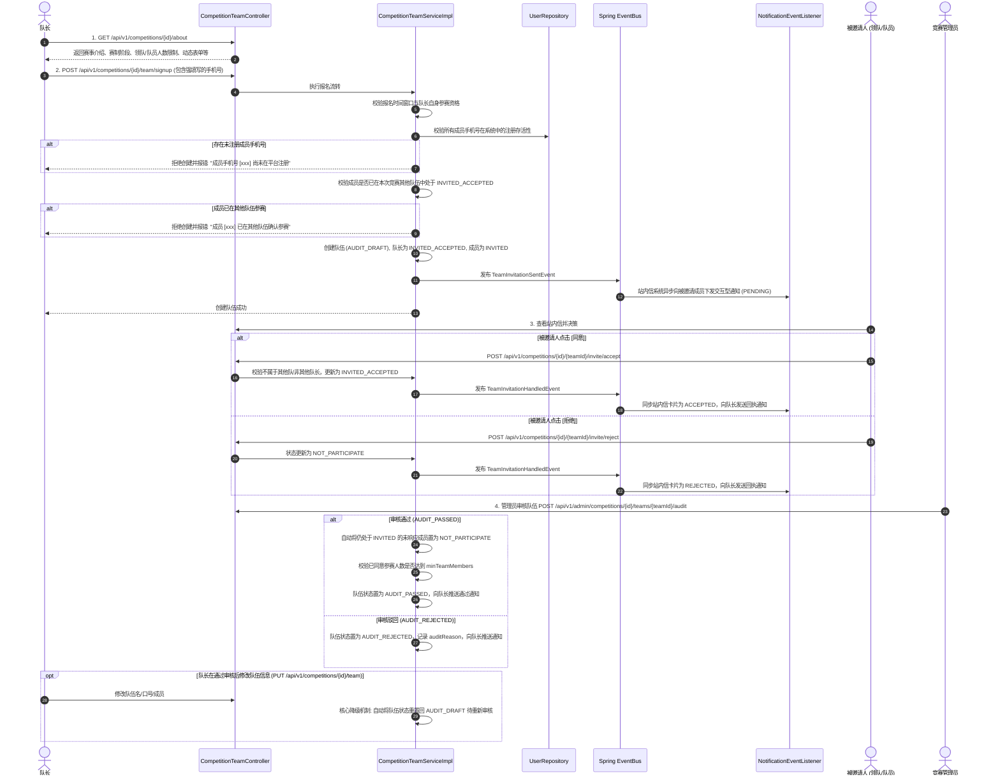

# Volur Lite 竞赛组队报名、成员强校验与邀请流转体系重构设计与施工档案

- **执行日期**：2026-08-25
- **施工模块**：`volur-competition`, `volur-user`, `volur-notification`
- **文档类型**：业务全链路重构与设计归档

---

## 1. 业务重构背景与目标

为满足正规网络安全竞赛对参赛队伍的严肃性、成员注册存活性校验、防跨队冲突及多角色（队长/领队/队员）状态机流转需求，对既有的组队与邀请机制进行了全链路重构，打通**赛事详情介绍 -> 队伍报名与成员强校验 -> 站内信邀请通知 -> 成员确认决策 -> 管理员审核与状态降级**闭环。

---

## 2. 完整业务逻辑链条



---

## 3. 核心 API 契约设计

| HTTP 动词 | 请求路径 | 功能说明 | 核心参数/请求体 | 语义返回方法 |
| :--- | :--- | :--- | :--- | :--- |
| `GET` | `/api/v1/competitions/{competitionId}/about` | 获取赛事介绍与报名要求配置 | `@PathVariable Long competitionId` | `ApiResponseEntity.ok` |
| `POST` | `/api/v1/competitions/{competitionId}/team/signup` | 队长创建队伍并邀请领队/队员 | `TeamSignupRequestDTO`（强校验手机号） | `ApiResponseEntity.created` |
| `PUT` | `/api/v1/competitions/{competitionId}/team` | 队长修改队伍信息（通过审核后修改自动降级回 `AUDIT_DRAFT`） | `TeamUpdateRequestDTO` | `ApiResponseEntity.success` |
| `POST` | `/api/v1/competitions/{competitionId}/{teamId}/invite/accept` | 被邀请人确认接受入队邀请 | `TeamInviteAcceptDTO`（含动态表单数据） | `ApiResponseEntity.success` |
| `POST` | `/api/v1/competitions/{competitionId}/{teamId}/invite/reject` | 被邀请人拒绝入队邀请 | - | `ApiResponseEntity.success` |
| `DELETE`| `/api/v1/competitions/{competitionId}/{teamId}/invite/cancel` | 队长取消对指定成员的邀请 | `@RequestParam Long userId` | `ApiResponseEntity.success` |
| `GET` | `/api/v1/competitions/{competitionId}/team/me` | 查看我的队伍信息与成员列表 | `@CurrentUserId Long userId` | `ApiResponseEntity.ok` |
| `GET` | `/api/v1/competitions/{competitionId}/teams` | 获取本场竞赛已通过审核的参赛队伍 | `@PathVariable Long competitionId` | `ApiResponseEntity.ok` |
| `POST` | `/api/v1/admin/competitions/{competitionId}/teams/{teamId}/audit` | 管理员审核队伍（自动将未响应队员置为 `NOT_PARTICIPATE`） | `TeamAuditRequestDTO` | `ApiResponseEntity.success` |

---

## 4. 状态机与枚举规范

### 4.1 队伍审核状态 `TeamStatus`
- `AUDIT_DRAFT`：草稿 / 待审核状态（初始创建时、或审核通过后被队长修改队伍信息后的自动降级状态）；
- `AUDIT_PASSED`：审核通过（管理员审核通过，具备正式参赛资格）；
- `AUDIT_REJECTED`：审核驳回（附带 `auditReason` 审核意见）。

### 4.2 成员参赛状态 `MemberStatus`
- `INVITED`：已发出邀请，等待用户确认；
- `INVITED_ACCEPTED`：已同意加入队伍并确认参赛（队长默认此状态）；
- `NOT_PARTICIPATE`：不参与比赛（用户主动拒绝邀请，或管理员审核通过时仍未同意邀请的成员自动转为此状态）。

### 4.3 成员角色 `MemberRole`
- `CAPTAIN`：队长；
- `LEADER`：领队 / 指导老师；
- `MEMBER`：普通队员。

---

## 5. 安全与并发防护机制

1. **成员注册存活性强校验**：
   - 队长在报名时填入领队与队员手机号，系统首先通过 `userRepository.findByPhone(phone)` 校验是否在平台已注册；若存在未注册手机号，直接阻断队伍创建并给出友好报错，杜绝伪造无效账号占位。
2. **跨队伍重复参赛与队长身份冲突校验**：
   - 用户在接受邀请或被报名时，严格核验该用户在同一场竞赛中是否已经在其他队伍处于 `INVITED_ACCEPTED` 或已是其他队的队长，防止一人多队、多重参赛作弊。
3. **审核通过自动收敛未响应队员**：
   - 管理员通过审核瞬间，将队伍中仍处于 `INVITED` 状态的成员批量自动转为 `NOT_PARTICIPATE`，确保进入正式比赛阶段的所有队伍成员数据准确一致。
4. **修改队伍信息安全降级**：
   - 已通过审核（`AUDIT_PASSED`）的队伍，一旦队长修改队伍名称、口号或增删队员，后端强制自动将其重置为 `AUDIT_DRAFT`，防止队伍借壳绕过资质审核。

---

## 6. 构建与验证结果

执行 Maven 全量编译：
```bash
mvn clean compile -DskipTests
```
全平台 12 个模块全部构建通过 (`BUILD SUCCESS`)。
