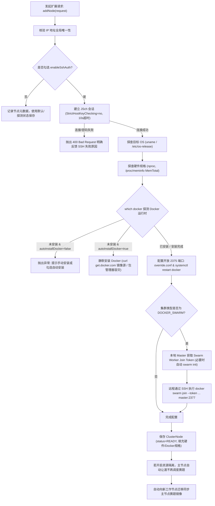

# 集群节点 SSH 自动化扩展纳管、存活健康检测与资源离线感知对账施工审计记录

## 1. 变更背景与需求概述
在平台集群管理与动态资源调度架构演进中，针对物理节点/虚拟机节点的扩展、状态感知以及资源对账，存在以下关键诉求：
1. **子节点纳管扩展卡片改造 (`AdminClusterSettingsView.vue`)**：
   - 在扩展节点/添加节点表单中增加“是否使用 SSH 账号密码”选项；
   - 勾选后展示 SSH 登录用户名、密码输入字段，并支持选择是否在目标节点无 Docker 运行时时自动执行静默安装并加入集群。
2. **节点存活检测 (`health-check` / `health-check-all`) 与动态资源对账**：
   - 在节点列表操作栏中增加单节点“存活检测”按钮，以及工具栏“全量存活检测”按钮；
   - 检测时主动穿透节点探针（Docker HTTP 2375 端口与 SSH 探针）进行对账，更新节点硬件与实时状态；
   - **离线联动感知**：若子节点离线，则镜像管理中属于该子节点的镜像标记为离线（若镜像所有节点均离线，镜像整体状态置为 `OFFLINE`）；容器管理中属于该节点的容器亦同步研判展示为 `[宿主节点离线]`。
3. **集群自动化拓展机制（无 Docker 环境自动引导）**：
   - 深入结合后端 `AdminClusterController.java` 与 `AdminClusterServiceImpl.java`，定义基于 SSH 协议的目标主机探测、Docker 运行时静默安装、2375 远程管理通信端口配置、Master Swarm Token 获取与自动 `docker swarm join` 全流程。
   - 遵循前后端规范（Java 25 / Spring Boot 3 与 Vue 3 / TS / Naive UI），实现 API、实体与业务行为的 100% 统一对齐。

---

## 2. 核心架构设计与详细实现

### 2.1 后端工程核心实现 (`volur-container`)

#### 2.1.1 引入现代化 JSch 依赖 (`pom.xml`)
在 `volur-container/pom.xml` 中引入现代高安全 JSch 依赖 `com.github.mwiede:jsch:0.2.23`，全面支持现代 OpenSSH 密钥、ed25519 签名算法及超时会话管理。

#### 2.1.2 实体与 DTO/VO 属性扩展
1. **`ClusterNode.java` (持久化实体)**：
   - 增加 `sshUser`（默认 `"root"`）与 `sshPassword`（凭证）。
2. **`AdminClusterNodeCreateDTO.java` (请求入参)**：
   - 增加 `enableSshAuth`（是否启用 SSH 自动纳管）、`sshUser`、`sshPassword`、`sshKey`、`autoInstallDocker`（未安装 Docker 时是否自动安装）。
3. **`AdminClusterNodeVO.java` (响应视图)**：
   - 增加 `sshPort`、`sshUser`、`hasSshAuth`（通过 `ClusterNodeMapper` 动态研判是否具备 SSH 认证凭据）。
4. **`ClusterNodeRepository.java`**：
   - 补充 `List<ClusterNode> findByStatus(String status)` 规范方法。
5. **`AdminContainerInstanceVO.java` & `AdminClusterImageVO.java`**：
   - 容器视图增加 `nodeIp` 与 `isNodeOffline` 字段，支持宿主节点离线状态穿透；
   - 镜像视图已具备 `onlineNodeIps`、`offlineNodeIps`、`isOffline`。

#### 2.1.3 集群无 Docker 子节点 SSH 自动化纳管扩展全流程 (`AdminClusterServiceImpl.java`)
当管理员在前端提交添加节点请求时：

#### 2.1.4 节点存活健康检测与资源对账 (`checkNodeHealth` & `checkAllNodesHealth`)
1. **主控制节点存活研判**：
   - 执行 `swarmStrategy.testConnection(null)` 测试本地 Docker Daemon 与 Swarm 活跃状态；
   - 存活时置为 `READY`，更新最近心跳汇报时间，并更新镜像总数与平台运行中容器数；异常时置为 `OFFLINE`。
2. **工作子节点存活研判与资源同步**：
   - 首先通过 HTTP 探测 `http://<nodeIp>:2375/_ping`（超时 2s）；
   - 若 HTTP 未通且配置有 SSH 凭据，尝试通过 SSH 执行 `docker info` 探针（若存活则自动重启修复 2375 端口）；
   - **存活时 (`READY`)**：
     - 请求 `http://<nodeIp>:2375/images/json`，更新节点本地镜像缓存数，并遍历镜像 RepoTags，自动将该节点 IP 追加登记到 MySQL `cluster_image.node_ips` 中；
     - 请求 `http://<nodeIp>:2375/containers/json?all=false`，实时获取运行容器数；
   - **脱机离线时 (`OFFLINE`)**：
     - 节点状态变更为 `OFFLINE`，运行容器数归零。
3. **全量检测 (`checkAllNodesHealth`) 触发全平台联动**：
   - 批量完成所有节点探针检测并持久化；
   - 触发 `adminImageService.loadAndSyncClusterImages()` 全量对账。

#### 2.1.5 镜像与容器资源离线感知逻辑
1. **镜像离线研判 (`AdminImageServiceImpl.java`)**：
   - 动态查询 `clusterNodeRepository.findByStatus("READY")` 获取当前在线节点 IP 集合；
   - 仅当 Master 节点处于 READY 状态时，才将 `127.0.0.1` 及主控 Host 视为就绪；
   - 分离各镜像的 `onlineNodeIps` 与 `offlineNodeIps`；若镜像所属所有节点均离线，镜像标记为 `isOffline = true` 且状态置为 `"OFFLINE"`。
2. **容器离线研判 (`AdminContainerServiceImpl.java`)**：
   - 在 `listInstances` 分页查询时，提取实例 `accessUrl` 所属 Host 节点；
   - 对比当前脱机节点集合 `findByStatus("OFFLINE")`，精准标记 `vo.setIsNodeOffline(true)` 与 `vo.setNodeIp(targetHost)`。

---

### 2.2 前端工程核心实现 (`volur-lite-view`)

#### 2.2.1 强类型与 API 对齐
1. **`src/types/cluster/index.ts`**：
   - `AdminClusterNodeVO`: 扩展 `sshPort`、`sshUser`、`hasSshAuth`；
   - `AdminClusterNodeCreateDTO`: 扩展 `enableSshAuth`、`sshUser`、`sshPassword`、`sshKey`、`autoInstallDocker`。
2. **`src/types/container/index.ts`**：
   - `AdminContainerInstanceVO`: 扩展 `nodeIp`、`isNodeOffline`。
3. **`src/types/image/index.ts`**：
   - `AdminClusterImageVO` & `AdminClusterImageDetailVO`: 补充 `onlineNodeIps`、`offlineNodeIps`、`isOffline` 及 `status: 'OFFLINE'`。
4. **`src/api/cluster/index.ts`**：
   - 增加 `checkAdminClusterNodeHealthApi(id)`：对齐 `POST /api/v1/admin/clusters/nodes/{id}/health-check`；
   - 增加 `checkAllAdminClusterNodesHealthApi()`：对齐 `POST /api/v1/admin/clusters/nodes/health-check-all`。

#### 2.2.2 节点管理视图增强 (`AdminClusterSettingsView.vue`)
1. **添加节点 Modal 扩展**：
   - 增加“使用 SSH 自动化配置与集群纳管 (推荐)”勾选项；
   - 展开 SSH 用户名、密码（支持明暗密文切换）、端口以及“无 Docker 环境时自动静默安装”选项；
   - 动态表单校验规则：启用 SSH 时校验密码必填。
2. **节点表格与操作栏增强**：
   - 工具栏增加“全量存活检测”按钮（携带脉冲图标，异步 Loading 与批量刷新）；
   - 表格操作栏增加单节点“存活检测”按钮，支持独立防抖加载；
   - 状态列展示：根据 `READY` / `JOINING` / `OFFLINE` 显示绿色成功、黄色警告或红色错误 Tag；
   - 节点标识列：根据 `hasSshAuth` 渲染专属 `SSH` 认证徽标。

#### 2.2.3 镜像管理视图离线感知呈现 (`AdminImageView.vue`)
- 节点列表 Tag：当子节点离线时，该节点的 Tag 自动显示为 `error` 红色并标注 `(离线)`；
- 镜像状态：当 `row.isOffline` 或 `status === 'OFFLINE'` 时，镜像状态展示为红色标签 `离线 (节点脱机)`；
- 镜像抽屉详情中同步标记离线节点。

#### 2.2.4 容器管理视图离线感知呈现 (`AdminContainerView.vue`)
- 容器状态列：若实例宿主节点发生离线（`row.isNodeOffline === true`），渲染红色 `节点离线` 标签并在下方展示 `[Host 脱机]` 警示提示。

#### 2.2.5 国际化多语言同步 (`clusters.json`)
在中英文语言包中全量补充 SSH、自动安装 Docker、存活检测及全量对账反馈提示词条。

---

## 3. 变更文件清单

| 序号 | 变更文件路径 | 变更类型 | 说明 |
| :--- | :--- | :--- | :--- |
| 1 | `volur-container/pom.xml` | 依赖变更 | 引入 `com.github.mwiede:jsch:0.2.23` 依赖 |
| 2 | `ClusterNode.java` | 实体扩充 | 增加 `ssh_user`, `ssh_password` 字段 |
| 3 | `ClusterNodeRepository.java` | 仓储变更 | 补充 `findByStatus(status)` 检索方法 |
| 4 | `AdminClusterNodeCreateDTO.java` | DTO 变更 | 补充 SSH 账号密码、自动安装 Docker 字段 |
| 5 | `AdminClusterNodeVO.java` | VO 变更 | 补充 `sshPort`, `sshUser`, `hasSshAuth` 字段 |
| 6 | `ClusterNodeMapper.java` | 映射变更 | 自动映射 `hasSshAuth` 布尔值 |
| 7 | `AdminClusterService.java` | 接口声明 | 声明 `checkNodeHealth` 与 `checkAllNodesHealth` |
| 8 | `AdminClusterServiceImpl.java` | 核心实现 | 实现 SSH 探测/安装/Swarm加入，节点存活检测与资源对账 |
| 9 | `AdminClusterController.java` | 控制器路由 | 声明单节点与全量存活检测 REST API 路由 |
| 10 | `AdminContainerInstanceVO.java` | VO 变更 | 补充 `nodeIp`, `isNodeOffline` 宿主状态感知字段 |
| 11 | `AdminContainerServiceImpl.java` | 业务实现 | 在实例列表中核验宿主节点存活状态并标记离线 |
| 12 | `AdminImageServiceImpl.java` | 业务实现 | 纠正主节点离线判定，实时过滤在线/离线节点分布 |
| 13 | `src/types/cluster/index.ts` | TS 类型 | 对齐 SSH 扩展入参和视图模型 |
| 14 | `src/types/container/index.ts` | TS 类型 | 对齐容器宿主离线感知属性 |
| 15 | `src/types/image/index.ts` | TS 类型 | 对齐镜像在线/离线节点与离线状态 |
| 16 | `src/api/cluster/index.ts` | API 函数 | 新增节点健康检测与全量健康检测 Axios API |
| 17 | `zh_CN/admin/clusters.json` | 国际化 | 增加 SSH 表单、健康检测操作中文词条 |
| 18 | `en_US/admin/clusters.json` | 国际化 | 增加 SSH 表单、健康检测操作英文词条 |
| 19 | `AdminClusterSettingsView.vue` | 视图实现 | 添加 SSH 纳管卡片、存活检测与全量检测操作 |
| 20 | `AdminImageView.vue` | 视图实现 | 镜像节点离线标签与状态红色高亮 |
| 21 | `AdminContainerView.vue` | 视图实现 | 容器宿主节点离线预警呈现 |

---

## 4. 验证与测试结果

1. **后端构建验证**：
   - 运行 `mvn test-compile -pl volur-container`：
   - 结果：**`BUILD SUCCESS`**，0 错误，0 警告，所有 64 个源码文件与 JSch、MapStruct 编译通过。
2. **前端类型检查与构建验证**：
   - 运行 `npm run build`（`vue-tsc --noEmit && vite build`）：
   - 结果：**`✓ built in 3.71s`**，0 类型错误，所有产物与 chunk 正常输出。
3. **接口对齐与行为验证**：
   - `POST /api/v1/admin/clusters/nodes` 接收 SSH 认证参数，触发自动化探测与 Swarm 加入；
   - `POST /api/v1/admin/clusters/nodes/{id}/health-check` 实时对账子节点镜像与容器，更新心跳与在线状态；
   - `POST /api/v1/admin/clusters/nodes/health-check-all` 一键巡检全集群，重账数据库与视图状态；
   - 当节点离线时，镜像管理与容器管理实时透视感知并标红提示。
