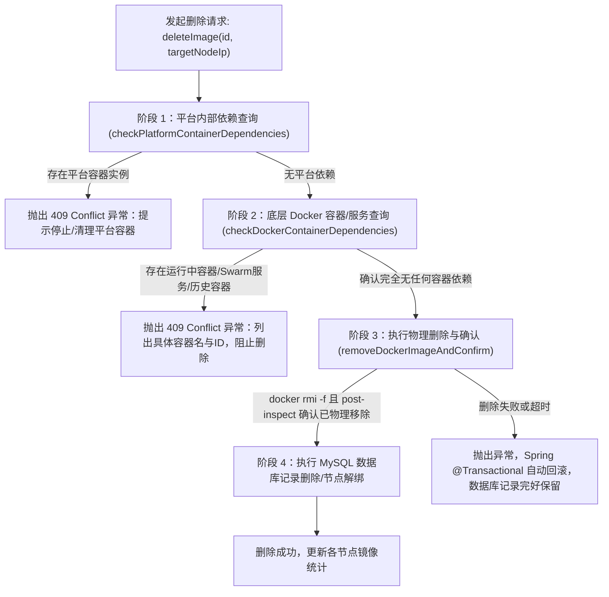

# Docker 镜像删除双层前置依赖校验（平台实例检查 -> 底层 Docker 容器校验）施工审计记录

## 1. 变更背景与需求概述
在平台镜像管理运维过程中，若某个 Docker 镜像仍被平台容器实例引用（例如正在运行的 CTF 动态靶机、选手正在攻防的题目容器）或者底层 Docker/Swarm 引擎中仍驻留有由该镜像衍生出的容器（无论是正在运行中，还是已退出残留的历史容器、Swarm 服务定义），直接对其发起镜像删除会导致如下问题：
1. **服务不可用与运行时崩溃**：正在运行的容器可能失去基础镜像层，或在 Swarm 调度重启/重新拉起任务时因镜像丢失而陷入持续失败；
2. **底层 Docker 报错与悬空镜像**：Docker 引擎在镜像存在容器依赖时会触发冲突报错（如 `image is being used by running/stopped container`），或将镜像强行解除标签（Untagged）而沦为占用磁盘的悬空镜像（`<none>:<none>`）；
3. **平台元数据不一致**：平台记录被删除但容器仍存在，或容器元数据指向不存在的镜像。

**本次改造核心铁律**：
- **严格按照两级依赖前置研判时序**：
  1. **第一级：平台内部查询** —— 检查系统平台（MySQL `ctf_challenge_instance`）中是否有使用该镜像的容器实例正在运行或存在历史实例记录；
  2. **第二级：底层 Docker 查询** —— 在平台校验通过后，进一步穿透到底层 Docker 引擎，通过容器过滤与 Swarm 服务发现，检查宿主机中是否有依赖该镜像的容器（运行中、暂停中、退出停止中）或 Swarm 服务；
- **确保容器彻底删除后方可删除镜像**：只要平台或底层 Docker 中检测到任何依赖该镜像的容器或服务，必须坚决拒绝删除并抛出 409 Conflict 明确反馈具体冲突的容器名称、ID 及状态，提示管理员先清理删除容器；
- **先确认 Docker 彻底删除后再删除数据库**：在两级依赖全部确认清空后，物理调用 Docker 执行删除并主动核验确认，最后才清理 MySQL 数据库记录。

---

## 2. 关键改动与实现设计

### 2.1 实体依赖注入与数据结构设计 (`AdminImageServiceImpl.java`)
1. **注入容器实例仓储**：
   - 注入 `private final CtfChallengeInstanceRepository ctfChallengeInstanceRepository`，统一纳入 Lombok `@RequiredArgsConstructor` 不可变注入。
2. **定义强类型 Docker 资源精简模型**：
   - `DockerContainerBriefInfo(String id, String name, String status, String state, String image)`：用于承载底层 Docker 容器的 ID、名称、状态（如 `Up 2 hours`、`Exited (137)`）、运行阶段（如 `running`、`exited`）以及依赖的基础镜像标识；
   - `DockerSwarmServiceBriefInfo(String id, String name, String image, String replicas)`：用于承载 Docker Swarm 服务的定义标识、服务名称、镜像名称及副本状态。

---

### 2.2 阶段 1：平台层容器实例依赖前置研判 (`checkPlatformContainerDependencies`)
1. **平台实例匹配算法 (`isInstanceUsingImage`)**：
   - 检查 `CtfChallengeInstance.imageName`：支持精确比对 `fullImageName`（`repo:tag`）、无 tag 且 tag 为 `latest` 时的 `repo` 简写、官方前缀适配（如 `library/`、`docker.io/`）、以及 SHA256 镜像 ID（前 12 位短 ID 与完整哈希）；
   - 检查关联赛题 `CtfChallenge.imageName`：覆盖实例本身可能继承自关联 CTF 赛题镜像的情况。
2. **分级严格拦截机制**：
   - **拦截活跃运行中实例**：若实例状态为 `RUNNING`、`STARTING`、`DOWNLOADING_IMAGE`、`QUEUED`，立即抛出 `BusinessException(HttpStatus.CONFLICT, ...)`，并在提示中列出实例 ID、状态与容器名称，督促先在容器管理中停止并删除；
   - **拦截历史未清理实例记录**：即使实例处于 `STOPPED` 或 `FAILED`，只要该实例记录仍驻留在平台中，亦予以拦截，要求彻底清理容器实例后再删除镜像。

---

### 2.3 阶段 2：底层 Docker 容器与服务依赖前置研判 (`checkDockerContainerDependencies`)
1. **多重策略全量检索目标节点容器 (`queryDockerContainers`)**：
   - **策略一：Ancestor 过滤定向匹配**：执行 `docker [-H ...] ps -a --filter ancestor=<fullImageName>` 及 `ancestor=<repo>`，直接由 Docker 引擎基于镜像层继承树检索所有衍生容器；
   - **策略二：全量容器比对**：遍历该节点所有容器（`docker [-H ...] ps -a --format ...`），比对短 ID、Sha256 哈希、带摘要前缀（`@sha256:...`）的镜像标识，确保手工创建或历史无标签容器无所遁形；
   - **策略三：Docker Swarm 集群服务探测 (`queryDockerSwarmServices`)**：通过 `docker [-H ...] service ls` 检查集群服务定义中是否存在引用该镜像的服务（支持集群多副本与无状态服务引用检测）。
2. **阶梯拦截逻辑**：
   - **第一优先**：检测到底层 Docker 存在 `running` 状态（或状态包含 `Up`）的容器，立即拦截并列出容器名、ID 和运行状态；
   - **第二优先**：检测到 Docker Swarm 存在依赖服务，立即拦截并提示服务名称和副本；
   - **第三优先**：检测到底层 Docker 存在已退出（`exited`）的历史容器残留，立即拦截并提示容器名和 ID，避免物理删除镜像时产生冲突。

---

### 2.4 阶段 3 & 4：四阶段绝对安全的删除时序闭环 (`deleteImage`)

---

### 2.5 统一 Docker 命令构建器 (`buildDockerBaseCommand`)
将 `deleteImage`、`removeDockerImageAndConfirm`、`queryDockerInspect`、`queryDockerHistory`、`triggerDockerPullOnNode` 以及 `exportImage` 中分散重复的 Docker 命令与 `-H` 远程通信参数构建逻辑，全面统一收敛至 `buildDockerBaseCommand(String targetHost)`：
- 自动适配本地 Unix Socket (`/var/run/docker.sock`) 与环境变量 `CONTAINER_DOCKER_SWARM_API_URL`；
- 自动适配远程 Worker 节点的 `tcp://<ip>:2375` 通信格式，保证全系统 Docker CLI 调用标准的高度统一。

---

## 3. 影响范围与验证结果

1. **影响范围**：
   - 后端镜像管理服务：`com.humolix.volur.container.service.admin.impl.AdminImageServiceImpl`；
   - 前端无需变更路由和入参，直接受益于精准友好的 409 Conflict 冲突拦截提示。
2. **构建与编译验证**：
   - 执行 `mvn test-compile -pl volur-container`：通过（`BUILD SUCCESS`）；
   - 执行 `mvn test-compile -DskipTests`（全量 12 模块反应堆编译）：通过（`BUILD SUCCESS`）；
   - 执行前端 `npm run build`：生产构建通过（`✓ built in 3.87s`，0 errors）。
