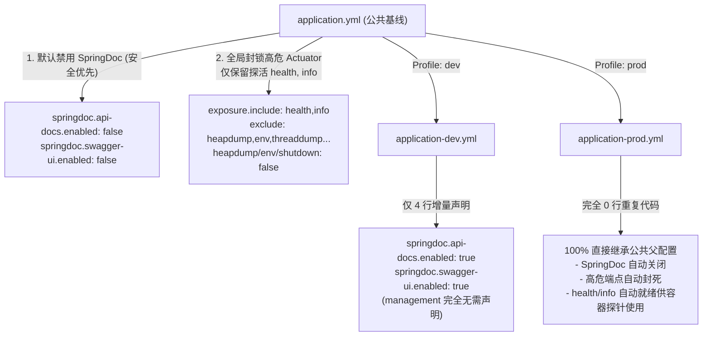

# SpringDoc 与 Actuator 生产环境加固与配置继承零冗余重构

## 1. 变更背景与安全隐患剖析

在 Spring Boot 企业级应用开发与部署中，**SpringDoc (Swagger / OpenAPI)** 和 **Spring Boot Actuator** 是提高开发调试效率与可观测性的重要工具，但在生产环境中若未进行严格的 Profile 隔离与访问控制，将成为攻击者信息搜集与权限突破的核心突破口：

### 1.1 SpringDoc OpenAPI 生产泄露风险
1. **接口资产与攻击面测绘**：生产环境下若开放 `/v3/api-docs` 或 `/swagger-ui.html`，外部未授权攻击者可直接获取全系统所有控制器、隐藏路由、内部管理端点（如 `/api/v1/admin/**`）、数据结构（DTO/VO Schema）、必填字段与参数校验规则；
2. **测试载荷辅助**：攻击者可通过 API Schema 准确探测应用依赖结构与业务逻辑边界，从而实施针对性的越权、注入或逻辑攻击。

### 1.2 Actuator 敏感端点（/heapdump、/env 等）致命威胁
1. **`/actuator/heapdump` 内存快照外泄**：攻击者一旦下载 JVM 堆转储文件（Heap Dump），可直接从中提取内存中缓存的用户敏感信息、数据库明文密码、JWT 私钥签名秘钥（`volur.jwt.secret`）、Redis/云厂商访问凭证；
2. **`/actuator/env` 环境变量泄露**：直接暴露部署主机环境变量、应用配置属性及系统路径；
3. **`/actuator/threaddump`、`/actuator/beans`、`/actuator/mappings`**：暴露运行时类加载全景、Spring 内部 Bean 依赖拓扑与请求映射全貌；
4. **`/actuator/shutdown`**：若暴露可直接导致未经授权的应用被远程直接关机（拒绝服务攻击 DoS）。

---

## 2. 方案 A：Spring Boot 配置继承与零冗余架构

针对开发环境与生产环境配置容易重复冗余的问题，本方案充分利用 Spring Boot 的**父子级联配置继承体系（Configuration Inheritance & Profile Override）**：



### 2.1 公共父配置基线 ([`application.yml`](file:///Users/humolix/Documents/Dev/Volur-Lite/src/volur-lite-platform/volur-server/src/main/resources/application.yml))
1. **SpringDoc 默认静默**：
   - `springdoc.api-docs.enabled: false`（显式禁用，无环境变量注入）
   - `springdoc.swagger-ui.enabled: false`（显式禁用，无环境变量注入）
   - `springdoc.show-actuator: false`
2. **Actuator 安全基线与容器存活支持**：
   - 暴露 `health, info` 端点，供 Docker Compose `healthcheck`、Kubernetes / K3s 的 `livenessProbe` / `readinessProbe` 执行探活；
   - 显式在 `exposure.exclude` 与各 `endpoint.*.enabled: false` 中封死 `heapdump`, `env`, `threaddump`, `beans`, `mappings`, `configprops`, `shutdown` 等所有高危敏感端点。

### 2.2 开发环境增量开启 ([`application-dev.yml`](file:///Users/humolix/Documents/Dev/Volur-Lite/src/volur-lite-platform/volur-server/src/main/resources/application-dev.yml))
- 仅需 4 行配置覆写开启 SpringDoc 接口文档调试支持（显式硬编码 `true`，无环境变量注入）：
  ```yaml
  springdoc:
    api-docs:
      enabled: true
    swagger-ui:
      enabled: true
  ```
- **完全删除冗余的 `management:` 配置块**，自动继承父配置中的安全基线。

### 2.3 生产环境零冗余继承 ([`application-prod.yml`](file:///Users/humolix/Documents/Dev/Volur-Lite/src/volur-lite-platform/volur-server/src/main/resources/application-prod.yml))
- **彻底删除 `springdoc:` 与 `management:` 冗余代码**（共精简清理 35+ 行代码）；
- 生产环境启动时自动直接继承 `application.yml`：
  - SpringDoc OpenAPI / Swagger 保持禁用（未授权探测直接 404）；
  - 高危监控端点严格封禁；
  - `health` 端点正常就绪供容器基础设施探测。

---

## 3. 纵深防御机制与效果评估

| 检查项 | 开发环境 (`dev`) | 生产环境 (`prod`) | 防御效果 |
| :--- | :--- | :--- | :--- |
| **SpringDoc / Swagger** | 激活开启 | 默认关闭（直接继承父配置） | 生产请求直接返回 404，阻断攻击面信息泄露 |
| **`/actuator/heapdump`** | 禁用 (`false`) | 禁用 (`false`) | 杜绝 JVM 堆内存快照与明文秘钥泄露 |
| **`/actuator/env`** | 禁用 (`false`) | 禁用 (`false`) | 杜绝主机环境变量与系统属性泄露 |
| **`/actuator/health`** | 开放 | 开放 | 支持云原生编排探活，且不包含凭证信息 |
| **配置文件代码冗余度** | 0 冗余 `management` | 0 冗余 `management` 与 `springdoc` | 极简维护，统一由父配置控制安全基线 |

---

## 4. 验证与审计结果

- 平台全模块自动化测试构建：在 `src/volur-lite-platform` 根目录执行 `mvn test`，全平台 12 个模块全部测试通过（`BUILD SUCCESS`，Tests run: 36, Failures: 0, Errors: 0）。
