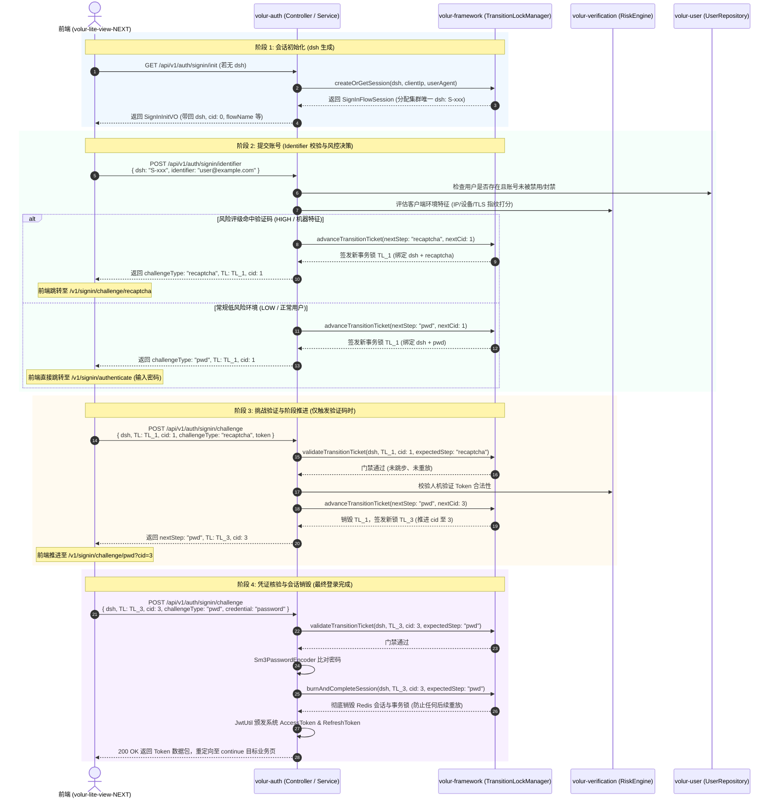

# Volur Lite - Google Accounts 规范分布式身份认证流转机制与系统协同架构设计

本文档规范并记录了 Volur Lite 平台复用 Google Accounts（Gaia / GlifWebSignIn 架构）的核心认证流转机制，包括分布式会话句柄（`dsh`）、事务流转票据（`TL`）、挑战计数器（`cid`）、防跳步与防重放防线，以及后端 `volur-framework` 与 `volur-auth` 模块间的分层协同架构。

---

## 目录
1. [架构背景与设计哲学](#1-架构背景与设计哲学)
2. [模块职责与分层解耦](#2-模块职责与分层解耦)
3. [系统流转协作示意图 (Mermaid)](#3-系统流转协作示意图-mermaid)
4. [核心凭证防伪与安全防线机制](#4-核心凭证防伪与安全防线机制)
5. [前后端接口契约与流转规范](#5-前后端接口契约与流转规范)
6. [前端状态机与路由映射对照](#6-前端状态机与路由映射对照)

---

## 1. 架构背景与设计哲学

在现代化零信任（Zero Trust）体系中，传统将“账号密码”作为默认硬编码表单的设计存在严重缺陷（无法平滑演进到 Passkey 无密码登录、无法在输入密码前实施前置人机验证防撞库、无法抵御多因子认证跳步越权）。

Google Accounts 采用了 **“全要素平权化挑战模型（Factor-as-a-Challenge）”**：
1. **密码是挑战之一 (`challenge/pwd`)**：将密码降级为众多挑战的一种（知识型挑战），与人机验证（`challenge/recaptcha`）、两步动态口令（`challenge/2fa`）、设备确认（`challenge/device`）遵循同一套状态机接口；
2. **两阶段分离**：前端第一步仅提交 `identifier`，服务端根据环境风控评分动态决定下一步呈现何种挑战；
3. **高可用会话与防篡改跃迁**：引入 `dsh` 锚定跨集群分布式会话，引入 `TL` 密码学事务锁确保步骤单向流动。

---

## 2. 模块职责与分层解耦

系统遵循 **“骨架下沉、业务聚合、杜绝循环依赖”** 的分层设计原则：

```
                    ┌───────────────────────────────┐
                    │ volur-lite-view-NEXT (前端)   │
                    └───────────────┬───────────────┘
                                    │ HTTP RESTful
                                    ▼
┌───────────────────────────────────────────────────────────────────────────┐
│ volur-auth 模块 (身份认证业务领域层)                                      │
│ • Controller API (/api/v1/auth/signin/*)                                  │
│ • 账号存在性核验 (依赖 volur-user)                                         │
│ • 客户端风险评分与分支决策 (依赖 volur-verification)                      │
│ • 密码/验证码业务校验 (Sm3PasswordEncoder, CaptchaSDK)                    │
│ • 最终颁发业务 JWT Access/Refresh Token (JwtUtil)                         │
└───────────────────────────────────┬───────────────────────────────────────┘
                                    │ 依赖注入 (TransitionLockManager)
                                    ▼
┌───────────────────────────────────────────────────────────────────────────┐
│ volur-framework 模块 (通用安全基础设施层)                                 │
│ 包路径: com.humolix.volur.framework.security.flow                        │
│ • SignInFlowSession (分布式会话契约模型)                                  │
│ • TransitionLockManager (通用会话与事务锁管理器):                         │
│    - dsh 格式生成与 Redis 存储/过期维护 (TTL: 15min)                      │
│    - TL 的 HMAC-SHA256 密码学签名与高熵防伪生成                           │
│    - 防跳步 (Step Skipping) 与防重放 (Replay Attack) 门禁校验             │
│    - 会话原子核销与流转状态推演 (advance / burn)                         │
│ • 纯净基础设施：仅依赖 Redis/Crypto，不依赖任何业务实体与数据库表         │
└───────────────────────────────────────────────────────────────────────────┘
```

---

## 3. 系统流转协作示意图 (Mermaid)



---

## 4. 核心凭证防伪与安全防线机制

### 4.1 `dsh`（分布式状态句柄）防伪
* **规格**：`S-<9位集群实例号>:<16位微秒时间戳与高熵随机数>`（如 `S-969965009:1790527266429740`）；
* **服务端校验**：纯随机伪造将直接命中 Redis **Cache Miss**，系统立即抛出 `401 Unauthorized` 并重置流程；
* **客户端环境绑定**：服务端在 `SignInFlowSession` 中记录初始请求的 Client IP 和 User-Agent，跨异地 IP 冒用直接告警或熔断。

### 4.2 `TL`（事务流转锁）防伪
* **规格**：`ADG-<60位高熵签名哈希>`（如 `ADG-GRTbPbNl0pSndZCtatZwpc273Y1KxgoCFYDnvVdrHspzQ9BKk03FfMrdB24l`）；
* **签名防伪算法**：基于 `HmacSHA256` 签名。数据载荷包含 `dsh + cid + step + identifier + timestamp + salt`；
* **篡改即失效**：客户端篡改任何一个字符均无法匹配服务端计算的签名，直接返回 `403 Forbidden`；
* **双向交叉绑定（Cross-Binding）**：`TL` 严格与当前的 `dsh` 和 `cid` 强绑定，攻击者无法将在会话 A 生成的 `TL` 拿到会话 B 中复用；
* **防跳步（Step Skipping）**：若当前阶段为 `recaptcha`，直接提交 `pwd` 会因 `expectedStep` 不匹配被即刻拦截；
* **防重放（Anti-Replay）**：每次状态推进时，前序 `TL` 会被从 Redis 会话中**立即注销**，历史用过的 `TL` 再次提交会判定为已消费。

---

## 5. 前后端接口契约与流转规范

### 5.1 `GET /api/v1/auth/signin/init`
* **功能**：首访会话握手。若前端 URL 无 `dsh`，请求此接口分配全局分布式状态句柄。
* **响应视图 (`SignInInitVO`)**：
  ```json
  {
    "code": 200,
    "msg": "success",
    "data": {
      "dsh": "S-969965009:1790527266429740",
      "cid": 0,
      "flowName": "GlifWebSignIn",
      "flowEntry": "ServiceLogin"
    }
  }
  ```

### 5.2 `POST /api/v1/auth/signin/identifier`
* **功能**：提交账号标识并触发服务端风控打分，获取下一阶段挑战指派。
* **请求入参 (`SignInIdentifierRequestDTO`)**：
  ```json
  {
    "dsh": "S-969965009:1790527266429740",
    "identifier": "developer@humolix.com"
  }
  ```
* **响应视图 (`SignInFlowResponseVO`)**：
  ```json
  {
    "code": 200,
    "msg": "success",
    "data": {
      "dsh": "S-969965009:1790527266429740",
      "nextStep": "pwd",
      "challengeType": "pwd",
      "tl": "ADG-6NHq99XDFXWSCd2dyCZoR_Rk54c-YRyS6rocOPd96ijf18S-M9prnwq0L5Cv",
      "cid": 1,
      "completed": false
    }
  }
  ```

### 5.3 `POST /api/v1/auth/signin/challenge`
* **功能**：提交对应挑战的凭据（验证码、二次口令或密码）。
* **请求入参 (`SignInChallengeRequestDTO`)**：
  ```json
  {
    "dsh": "S-969965009:1790527266429740",
    "tl": "ADG-6NHq99XDFXWSCd2dyCZoR_Rk54c-YRyS6rocOPd96ijf18S-M9prnwq0L5Cv",
    "cid": 1,
    "challengeType": "pwd",
    "credential": "UserSecretPassword#2026"
  }
  ```
* **响应视图 (`SignInFlowResponseVO`)**：
  * 若完成全部验证：`completed: true`，并在附带的数据中下发系统正式的 `token`（包含 `accessToken`、`refreshToken`）；
  * 若仍需二次验证：`completed: false`，下发 `nextStep: "2fa"` 以及递增的 `cid: 2` 和新 `TL`。

---

## 6. 前端状态机与路由映射对照

前端工程（`src/volur-lite-view-NEXT`）中维护了与后端完全镜像的流转状态机：

| 阶段类型 (`step`) | 触发时机 | 前端路由与参数规范 | 状态说明 |
| :--- | :--- | :--- | :--- |
| **`init` / `identifier`** | 初始进入登录页 | `/v1/signin/identifier?dsh=S-...&flowName=GlifWebSignIn` | 输入邮箱/用户名。URL **不携带** `identifier` 明文，收敛至 `authFlowStore` 和 `sessionStorage`。 |
| **`recaptcha`** | 命中高风控机器特征 | `/v1/signin/challenge/recaptcha?TL=ADG-...&cid=1&dsh=S-...` | 验证人机。必须携带合法 `TL`，否则门禁拦截回退至首步骤。 |
| **`pwd`** | 知识型要素挑战（常规无风险或已通过验证码） | `/v1/signin/authenticate?TL=ADG-...&cid=1&dsh=S-...`<br>*(或 `/v1/signin/challenge/pwd?cid=3`)* | 输入用户密码。通过后核销 `TL`，完成登录。 |
| **`2fa` / `totp`** | 敏感异地或高安全等级账号 | `/v1/signin/challenge/2fa?TL=ADG-...&cid=4&dsh=S-...` | 输入 6 位动态验证码。 |
| **`device`** | 陌生移动端/新浏览器首次登录 | `/v1/signin/challenge/device?TL=ADG-...&cid=4&dsh=S-...` | 设备确认弹窗。 |
