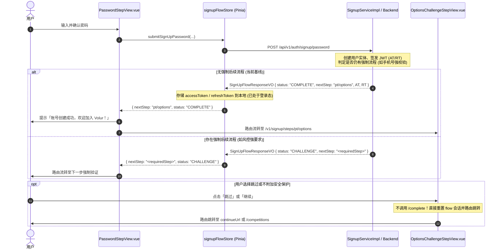

# 注册流程收敛至终端环节与解耦 options 页面 complete 调用审计方案

## 1. 变更背景

在原有的用户注册流转设计中，用户在完成最后一个必要注册环节（设置密码 `password`）后，后端返回状态机响应 `status: "CHALLENGE"` 并引导至可选安全设置步骤 `pt/options`。而在 `OptionsChallengeStepView.vue` 中，用户无论选择“跳过”还是“继续”，前端都依赖向后端发起 `POST /api/v1/auth/signup/complete` 请求来获取访问令牌并核销会话，以此判定流程是否结束。

这种模式存在以下职责倒置与架构缺陷：
1. **核心注册完成时机倒置**：用户的核心身份资产（`User` 与 `UserProfile`）以及访问凭据（`accessToken` 和 `refreshToken`）已在密码设置完成阶段由服务端持久化并签发。流程的必要终态已经在密码阶段闭环，不应由后续附加的非必选步骤来决定或通知前端“注册是否成功”。
2. **可选步骤误入必经流程**：`pt/options`（通行密钥 Passkey、两步验证 TOTP 等）本质为平台提供给用户的“可选账号安全加固措施”。用户应当有权随时跳过或稍后在个人中心配置，不应被强制绑定为状态机终止前的阻断节点。
3. **冗余的网络调用与脆弱的判定链**：前端通过在 `OptionsChallengeStepView` 调用 `/complete` 来获取令牌并判断流程结束，导致如果在跳转到 options 过程中用户刷新、网络抖动或直接关闭标签页，可能产生令牌未保存而流程中断的问题。

---

## 2. 核心架构重构设计

---

## 3. 具体修改点

### 3.1 后端服务层 (`SignupServiceImpl.java`)
- 在 `password(SignUpPasswordRequestDTO)` 方法中：
  - 用户持久化与 JWT 签发完成后，通过判断是否具有强制性后续步骤；
  - 在无强制性后续要求的常规流程下，直接将响应 VO 的 `status` 设为 `"COMPLETE"`，`nextStep` 设为 `"pt/options"`，并同时下发 `accessToken` 与 `refreshToken`；
  - 将事务锁凭据推进至 `pt/options`，使得用户后续若选择继续配置 Passkey 等选项时凭据合法。

### 3.2 前端状态流转层 (`src/store/modules/flow/signupFlow.ts`)
- 修改 `submitSignUpPassword` 方法签名与返回结果：
  - 结构化解构返回 `{ nextStep: data.nextStep, status: data.status || 'COMPLETE' }`；
  - 保持在接收到 `accessToken` 和 `refreshToken` 时写入 `localStorage`；
- 彻底清理 `completeSignUp` 方法与 `completeSignUpApi` 的依赖导入，消灭废弃兼容逻辑。

### 3.3 前端密码设置视图 (`PasswordStepView.vue`)
- 在 `handleNext` 提交密码响应后：
  - 解构获取 `nextStep` 与 `status`；
  - 当 `status === 'COMPLETE'` 时，直接向用户弹出 `账号创建成功，欢迎加入 Volur！` 全局提示；
  - 随后按服务端返回的 `nextStep` 平滑导航至 `/v1/signup/steps/pt/options`。

### 3.4 前端保护选项视图 (`OptionsChallengeStepView.vue`)
- **彻底删除对 `/complete`（`completeSignUp`）的调用**：
  - `handleSkip` 与 `handleContinue` 方法不再发起异步网络请求；
  - 点击后直接重置本地 flow 会话（`signupFlowStore.resetFlow()`），并立即导航至目标重定向页面（`continueUrl` 或 `/competitions`）；
  - 移除了按钮上的冗余 `loading` 状态与未使用的 `computed` 依赖，极大提升交互流畅度。

### 3.5 前端通行密钥配置视图 (`passkeyProtectView.vue`)
- 在 `handleFinish` 中：
  - 移除原有的 `signupFlowStore.completeSignUp` 调用；
  - 注册 Passkey 成功后，点击继续直接重置 flow 会话并导航至目标重定向页面。

---

## 4. 影响范围与回归测试验证

1. **后端构建与单测**：
   - 执行 `mvn compile -pl volur-auth -am` 编译构建成功；
   - 执行 `mvn test -pl volur-auth`，44 个单元测试全部通过（0 Failures, 0 Errors）。
2. **前端类型校验与生产构建**：
   - 执行 `npx vue-tsc --noEmit`，零类型错误；
   - 执行 `npm run build`，Vite 生产包构建成功无异常。
