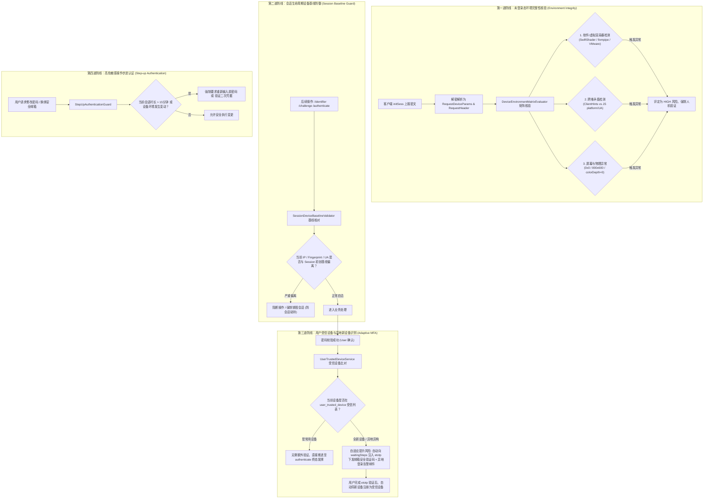

# 现代自适应风控系统落后性剖析与全链路演进架构设计方案

## 1. 现状审视与落后性深度对比

### 1.1 数据采集能力 vs 后端消费能力严重脱节（“采而不用，形同虚设”）
当前平台在会话初始化阶段（`/api/v1/session/initSess`）由前端通过 AES-GCM 密文向后端上报了极其丰富细致的多维硬件、环境与指纹数据，后端解密持久化为 `RequestDeviceParams` 与 `RequestHeader`，包含了多达 20 余项核心维度：

| 数据类别 | 前端采集字段 (`RequestDeviceParams` / `RequestHeader`) | 含义与价值 | 后端风控系统当前消费现状 |
| :--- | :--- | :--- | :--- |
| **图形硬件特征** | `renderer`, `vendor` | WebGL 显卡型号（如 RTX 4090 / Apple M3 / SwiftShader 软件渲染器） | **完全闲置 (0% 消费)** |
| **渲染指纹** | `canvasHash` | HTML5 Canvas 2D 绘图渲染哈希 | **完全闲置 (0% 消费)** |
| **屏幕物理参数** | `screenResolution`, `colorDepth` | 屏幕物理分辨率（如 `1920x1080`）与色深（如 `24`） | **完全闲置 (0% 消费)** |
| **系统与环境** | `osFamily`, `browserFamily`, `platform`, `language`, `timezone` | 操作系统、平台字串（如 `Win32`）、语言与客户端时区 | **完全闲置 (0% 消费)** |
| **自动化标记** | `isHeadless` | 客户端探测无头浏览器特征 | 仅作了简单的布尔判断，易被伪造绕过 |
| **Client Hints** | `secChUa`, `secChUaPlatform`, `secChUaMobile`, `secChUaPlatformVersion` | 现代浏览器高熵反爬反伪造头部 | **完全闲置 (0% 消费)** |
| **安全上下文** | `secFetchSite`, `secFetchMode`, `secFetchDest`, `origin`, `referer` | 跨域与请求来源安全标记 | **完全闲置 (0% 消费)** |

**核心痛点**：
目前后端风控核心入口 `RiskEvaluationEngine.evaluateComprehensiveRisk(clientIp, identifier, rawFp, scene)` 仅接收 `ip`、`identifier` 和一个可能为空的 Cookie 字符串 `rawFp`。**持久化在 `Session` 中的全量 `RequestDeviceParams` 与 `RequestHeader` 完全没有参与到风控决策中！**

---

### 1.2 跨维度环境自洽性核验（Cross-Dimension Consistency）完全缺失
黑产与自动化攻击工具（Puppeteer、Selenium、Playwright、逆向脚本）在伪造环境时，往往只能伪造局部字段，必然产生跨维度矛盾。现有系统对此完全免疫：
1. **显卡渲染器矛盾**：
   - 脚本声称是 `Windows 11` + `Chrome`，但 `renderer` 实际是 Linux 软件光栅化驱动 `Google SwiftShader`、`llvmpipe`、`Mesa OffScreen` 或虚拟机显卡 `VMware SVGA`；
   - 脚本声称是 `macOS`，但 `vendor` 却是 `Google Inc. (NVIDIA)`（现代 Mac 不存在 NVIDIA 显卡）。
2. **Client Hints 与 JS 环境矛盾**：
   - HTTP 头 `Sec-CH-UA-Platform: "Windows"`，但 JS 采集的 `platform` 却是 `Linux x86_64`；
   - `Sec-CH-UA-Mobile: ?0`（桌面），但 `screenResolution` 却是手机分辨率（如 `390x844`）。
3. **物理环境异常特征**：
   - 屏幕分辨率为 `0x0`、`800x600`（无头浏览器默认窗口尺寸）；
   - `colorDepth` 为 `0` 或异常值。

---

### 1.3 会话生命周期缺乏设备基线锚定（防中途会话劫持与中间人）
当前架构下，用户通过 `initSess` 获取 `dsh`，后续在 `/identifier`、`/challenge`、`/authenticate` 乃至登录后的敏感操作中推进：
- **漏洞点**：服务端只验证 `dsh` 与 `tl` 的对应关系。如果攻击者通过 XSS、网络嗅探或日志泄漏获取了 `dsh` 与 `tl`，并在不同的设备、不同的 IP 环境下提交，服务端**完全没有将当前请求的 IP、UA、指纹与会话初创时的基线比对**，无法拦截中间人或跨设备会话盗用。

---

### 1.4 “用户受信设备库”与“新设备/异地登录识别”完全空白
- **核心矛盾**：
  现有系统只知道某个 IP 或某个账号在 10 分钟内失败了多少次，**完全没有“用户-设备关联资产”的概念**。
  - 用户每天在自己的常用电脑上登录，系统无法感知这是“常用受信设备”；
  - 攻击者在海外未知新设备上使用撞库拿到的正确密码登录，系统也无法识别出这是“全新设备/高危异地”，导致输入密码后直接放行发牌。

---

### 1.5 高危敏感操作（修改密码、更换密保/安全邮箱）风控缺失
- 修改密码、换绑邮箱等高危接口目前仅依赖静态 JWT 鉴权；
- 缺少“敏感操作前环境自适应核验”与“步进认证（Step-up Re-authentication）”；一旦 Access Token 被盗取，黑客可瞬间改密撕票。

---

## 2. 现代自适应风控系统演进架构设计

针对上述痛点，设计覆盖“未登录人机识别 -> 登录态自适应认证 -> 登录后敏感操作提权”的三道自适应风控防线：



---

## 3. 详细设计与核心组件规范

### 3.1 核心组件 1：多维环境自洽性评估器 (`DeviceEnvironmentMatrixEvaluator`)
统一收敛在 `volur-verification` 或 `volur-security` 中，输入 `RequestDeviceParams` 与 `RequestHeader`，输出 `EnvironmentRiskReport`：
1. **虚拟化与无头特征（Weight: HIGH）**：
   - `renderer` 包含 `SwiftShader`, `llvmpipe`, `Mesa OffScreen`, `VirtualBox`, `VMware`, `Parallels`；
   - `vendor` 包含 `Brian Paul`, `Mesa Project`；
   - `isHeadless == true` 或 `userAgent` 包含 `HeadlessChrome`。
2. **跨维度矛盾检测（Weight: HIGH）**：
   - `platform` 为 `Win32`，但 `Sec-CH-UA-Platform` 为 `"macOS"` 或 `"Linux"`；
   - `platform` 声明为苹果系（`MacIntel`, `iPhone`），但 `renderer` 包含 `Direct3D` 或 `NVIDIA`；
   - `browserFamily` 为 `SAFARI`，但操作系统为 `Windows`。
3. **物理环境畸变检测（Weight: MEDIUM）**：
   - `screenResolution` 为 `0x0`, `800x600`, `1024x768` 且同时无音频上下文；
   - `colorDepth <= 8`。

---

### 3.2 核心组件 2：会话设备基线校验器 (`SessionDeviceBaselineValidator`)
在所有依赖 `dsh` 的后续请求（如 `identifier`、`challenge`、`authenticate`）前执行：
- 从当前请求提取真实 `clientIp`、`userAgent`、Cookie 中的 `fingerprint`；
- 与 `session.getRequestDeviceParams()` 锚定的基线做哈希对比；
- 若指纹发生突变或跨 C 段 IP 跃迁且 UA 家族完全变更，直接视为会话被跨域窃取，阻断并销毁会话。

---

### 3.3 核心组件 3：用户受信设备体系 (`UserTrustedDeviceService`)

#### 数据库持久化实体 (`user_trusted_device`)
支持增量升级脚本 `scripts/upgrade/upgrade_to_latest.sql`（具备幂等性）：
```sql
CREATE TABLE IF NOT EXISTS `user_trusted_device` (
    `id` BIGINT NOT NULL,
    `user_id` BIGINT NOT NULL,
    `device_hash` VARCHAR(64) NOT NULL,
    `device_name` VARCHAR(128) NULL,
    `os_family` VARCHAR(32) NULL,
    `browser_family` VARCHAR(32) NULL,
    `first_login_ip` VARCHAR(45) NULL,
    `last_login_ip` VARCHAR(45) NULL,
    `first_login_time` TIMESTAMP NOT NULL DEFAULT CURRENT_TIMESTAMP,
    `last_login_time` TIMESTAMP NOT NULL DEFAULT CURRENT_TIMESTAMP ON UPDATE CURRENT_TIMESTAMP,
    `is_trusted` TINYINT(1) NOT NULL DEFAULT 1,
    `created_at` TIMESTAMP NOT NULL DEFAULT CURRENT_TIMESTAMP,
    `updated_at` TIMESTAMP NOT NULL DEFAULT CURRENT_TIMESTAMP ON UPDATE CURRENT_TIMESTAMP,
    PRIMARY KEY (`id`),
    UNIQUE KEY `uk_user_device` (`user_id`, `device_hash`),
    INDEX `idx_user_id` (`user_id`)
) ENGINE=InnoDB DEFAULT CHARSET=utf8mb4 COLLATE=utf8mb4_unicode_ci;
```

#### 登录流自适应 MFA 编排逻辑
在 `SigninServiceImpl.challenge("pwd")` 验证密码正确后：
1. 提取当前 `user.getId()` 与 `session.getRequestDeviceParams().getDeviceHash()`；
2. 检索 `user_trusted_device` 表：
   - **命中受信记录**：更新 `last_login_ip` 与 `last_login_time`，直接推进至 `authenticate` 终态；
   - **未命中（新设备 / 异地首次登录）**：
     - 将 `SigninFlow.waitingSteps` 调整为 `["etotp", "authenticate"]`；
     - 自动触发 `emailService.sendVerificationEmail(...)` 下发登录验证码；
     - 向前端返回 `nextStep: "etotp"`，引导用户完成邮箱二次核验；
     - 用户在完成 `etotp` 挑战后，系统将该设备写入 `user_trusted_device` 表，并推进到 `authenticate` 终态完成登录。

---

### 3.4 核心组件 4：高危敏感操作（修改密码 / 换绑安全资料）防线
在用户登录后执行高危操作（如修改密码 `POST /api/v1/user/password`）时：
1. **步进认证（Step-up Re-authentication）**：
   - 必须提供原密码进行 Sm3 加密比对；
2. **设备一致性核验**：
   - 提取当前请求上下文的设备特征，核验该设备是否为当前用户的受信设备；
   - 若检测到在全新/异常设备上发起改密，强制要求输入发送至安全邮箱的验证码确认；
3. **改密成功后的安全连带**：
   - 自动使该用户之前下发的所有 Refresh Token 失效（除当前会话外），强制其他所有设备下线。
