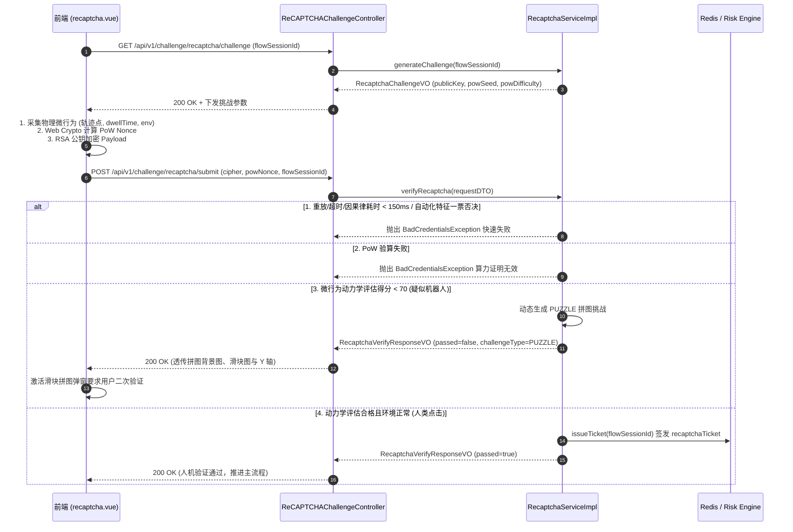

# reCAPTCHA 人机验证高危绕过漏洞修复与自研 CLICK 模式架构升级设计方案

## 1. 变更背景与漏洞核实

### 1.1 漏洞核实 (CWE-602 & CWE-807)
根据安全测试报告《2026-10-08-人机验证绕过报告.md》，对系统既有人机核验链路（前端 `recaptcha.vue` $\rightarrow$ 控制器 `ReCAPTCHAChallengeController.java` $\rightarrow$ 业务服务 `RecaptchaServiceImpl.java`）进行代码走查与实测审计，核实以下致命漏洞 100% 存在：
1. **服务端口袋解密与无条件签发（Blind Trust）**：
   - 服务端接收到前端提交的 RSA 密文后，仅调用 `decryptPayload` 解密出 JSON 字典；
   - 解密后未对 `riskScore`、`bio`（动力学微行为）以及环境指纹做任何合法性判断与阈值校验；
   - 只要密文能够被系统持有的 RSA 私钥正常解密（即使内容仅包含 `{}` 空对象），服务端便无条件直接调用 `issueTicket(flowSessionId)` 签发有效验签凭证；
2. **字段键名脱节与环境检测完全失效**：
   - 前端采集环境指纹并将自动化标记挂载在嵌套对象 `env.wd` 中；
   - 后端却检索根级字段 `payloadMap.get("webdriver")`，导致自动化判定逻辑实质上恒为 `false`；
   - 前端原生事件的 `isTrusted` 属性在执行 `JSON.stringify` 序列化时自动丢失，后端无法获知真实点击信任来源；
3. **前端存在自判与本地伪造逻辑**：
   - 前端 `recaptcha.vue` 内置的沙箱 iframe 中直接包含 `if (risk < 0.45) emit('success', mockToken)` 等伪造放行逻辑，属于典型的前端客户端越权判定缺陷；
4. **全链路沦陷后果**：
   - 黑客无需启动真实浏览器或模拟任何鼠标行为，仅需构造空载荷或伪造 JSON，使用后端公钥加密后发送至 `/api/v1/challenge/recaptcha/submit`，即可 100% 稳定获取有效人机票据 `recaptchaTicket`；
   - 该票据可直接注入登录、注册、邮箱验证码发送等各业务链路，导致人机防御形同虚设，引发批量扫号、撞库与邮件轰炸。

### 1.2 升级目标与设计约束
1. **保留低风险 CLICK 极简体验**：保持在正常人机交互和低风险场景下的单次点击（Click Checkbox）即通过的无感/低摩擦体验。
2. **拒绝外部第三方云端黑盒依赖**：坚决不引入 Cloudflare Turnstile、Google reCAPTCHA 等外部第三方托管服务作为 CLICK 模式的可选驱动，确保系统在私有化部署和内网隔离环境下的自主可控与稳定性。
3. **彻底清除 Turnstile 架构遗留代码**：彻底清理历史遗留的 `CloudTurnstileCaptchaProvider.java` 驱动类、枚举项及系统动态配置键，消除无用抽象。
4. **针对微行为模拟的纵深防御**：解决黑客使用自动化工具（如 `ghost-cursor`、贝塞尔曲线插值、柏林噪声）伪造鼠标运动微行为特征带来的绕过挑战。
5. **严格遵循系统开发规范**：坚持纯代码零注释（文档外置原则）、全链路快速失败（Fail-Fast）与零伪造兜底（Zero-Mock）。

---

## 2. 威胁建模：黑客能否通过模拟微行为传感数据绕过？

### 2.1 攻击面剖析与黑客拟真技术
攻击者在面对单纯的“鼠标轨迹收集+前端动力学特征检测”时，可通过以下技术进行高度逼真的微行为欺骗：
1. **三阶贝塞尔曲线与分形噪声（Spline + Perlin Noise）**：生成包含起步加速度、巡航减速、微颤抖和过冲回正的高拟真人性化坐标序列；
2. **真实人类轨迹池重放与微扰插值**：通过采集大量真实人类的历史轨迹样本，注入微小角度旋转与高斯扰动随机回放；
3. **浏览器底层 CDP 仿真注入**：使用 Chrome DevTools Protocol (`Input.dispatchMouseEvent`) 分发真实置标的鼠标事件，绕过简单的事件源检测。

### 2.2 防护结论与破局思路
- **结论**：**单纯依赖前端收集的微行为传感器数据，在数学和信号层面上不可能达成 100% 杜绝黑客伪造**。任何试图将纯 CLICK 模式打造成单一“银弹”的设计均存在被高级拟真脚本绕过的固有风险。
- **破局方案（多维纵深防御体系）**：
  必须打破“单点行为判断”的静态博弈，将低风险 CLICK 模式作为**漏斗顶层的第一道筛子**，并与**工作量证明（PoW）**、**物理反应时因果律**及**风控动态升阶（Dynamic Step-up to Puzzle）**形成立体防线：
  1. **算力锚点（Client Proof of Work）**：
     - 服务端下发随机 `powSeed` 与动态难度，前端必须通过 SHA-256 原生哈希计算出符合前导零要求的 Nonce；
     - 迫使黑客每次发包均需消耗端侧物理 CPU 算力，破坏大规模并发撞库与批量请求的经济可行性；
  2. **物理因果律与时序约束**：
     - 服务端记录挑战下发的绝对时间戳，严格校验提交时间差 $\Delta t$；
     - 人类对视觉元素的识别与神经反射时间存在物理下限（通常不低于 $150\text{ms}$）。提交耗时 $< 150\text{ms}$ 一律视为预计算或脚本自动化触发，直接拦截；
  3. **微行为动力学综合加权评估（Kinematics Score）**：
     - 服务端解密后提取微行为特征：轨迹点采样密度、按键按下至释放停留时长（Dwell Time）、移动总耗时、加速度方差分布、点击落点偏离中心度；
     - 任何关键指标缺失或不符合物理特征时扣分。对于评分处于可疑区间的请求，**不再简单返回拒绝，而是动态升阶为服务端完全可控的 `PUZZLE`（滑块拼图验证）**；
  4. **拼图升阶与后置业务风控闭环**：
     - 一旦触发升阶，服务端即时生成带有随机缺口与混淆背景的拼图挑战，要求二次交互；
     - 拼图缺口位置与滑块阻尼系数完全由服务端在内存或 Redis 中即时裁决，彻底粉碎无头浏览器的纯数学轨迹伪造。

---

## 3. 全链路改动与落地实施



### 3.1 基础设施与 Turnstile 残留清理
1. **删除冗余驱动类**：
   - 物理删除 `src/volur-lite-platform/volur-verification/src/main/java/com/humolix/volur/verification/captcha/provider/CloudTurnstileCaptchaProvider.java`；
2. **清理验证码枚举与系统配置**：
   - `CaptchaType.java`：移除 `CLOUD_TURNSTILE` 枚举项；
   - `SystemSettingKeys.java`：移除 `SYSTEM_SECURITY_CAPTCHA_TURNSTILE_SITE_KEY` 与 `SYSTEM_SECURITY_CAPTCHA_TURNSTILE_SECRET_KEY` 常量定义；
   - `SystemSettingInitializer.java`：清理系统启动时的 Turnstile 初始配置注入。

### 3.2 服务端架构重构与安全闭环 (`volur-security`)
1. **挑战与响应视图重构**：
   - `RecaptchaChallengeVO.java`：新增 `powSeed`（随机种子）与 `powDifficulty`（目标难度）字段；
   - `RecaptchaVerifyResponseVO.java`：新增动态升阶字段 `challengeType`、`backgroundImage`、`puzzleImage`、`puzzleY` 与 `promptText`。
2. **核心业务逻辑重构 (`RecaptchaServiceImpl.java`)**：
   - **挑战下发**：
     - 生成 32 字符安全随机数作为 `powSeed`，设定基线难度为 2（即 SHA-256 十六进制摘要需满足 `00` 前缀）；
     - 将 `powSeed` 与 `powDifficulty` 写入 `ChallengeContext` 会话上下文；
   - **全要素强校验**：
     - **时间戳与防重放**：会话仅允许一次性验证，使用后立即销毁；校验客户端耗时，低于 150ms 判定为违反人类神经传导因果律，直接阻断；
     - **PoW 算力验算**：执行 `DigestUtil.sha256Hex(powSeed + powNonce)`，严格比对前导零数量，防止脚本绕过计算；
     - **环境自动化一票否决**：解密载荷后精准提取 `env.wd`、`env.cdp`、`env.hook` 以及 User-Agent 中的 `Headless` 标识，任一命中立即抛出安全凭证异常；
     - **微行为动力学加权评分（Kinematics Score）**：
       - 提取轨迹采样点数（$\ge 5$）、按键按下持续时长（$30\text{ms} \le \text{dwell} \le 800\text{ms}$）、总运动时间（$150\text{ms} \le \text{duration} \le 10000\text{ms}$）、加速度方差（必须呈现自然变速特征，非恒速直线）、落点离中心距离（偏离容差以内）；
       - 综合评分达到 70 分及以上且环境清洁方判定为纯 CLICK 通过；
     - **动态无缝升阶为 PUZZLE**：
       - 当环境未命中明确自动化黑特征但动力学评分 $< 70$（疑似脚本拟真或高级重放）时，调用 `captchaGenerator` 动态生成滑块拼图切片与背景图，封装入响应实体，指示前端进入二级核验；
       - 当且仅当完全符合人类特征时，签发 `recaptchaTicket`。
3. **控制器层 (`ReCAPTCHAChallengeController.java`)**：
   - 根据 `responseVO.isPassed()` 返回动态状态提示；未放行但提供升阶载荷时返回详细提示引导前端弹出滑块。

### 3.3 前端安全加固 (`volur-lite-view-NEXT`)
1. **API 类型对齐 (`src/api/captcha.ts`)**：
   - `RecaptchaChallengeVO` 接口补充 `powSeed` 与 `powDifficulty`；
   - `RecaptchaVerifyResponseVO` 接口扩充 `challengeType`、`backgroundImage`、`puzzleImage`、`puzzleY` 等升阶模型。
2. **组件逻辑彻底去毒 (`src/components/security/recaptcha.vue`)**：
   - **清除本地伪造后门**：移除 iframe 内的自判 `risk < 0.45` 逻辑及前端直接生成 Token 并提交的越权逻辑；
   - **沙箱降级为纯传感器**：iframe 仅负责采集原生微行为指标（PointerEvent 序列、按键驻留时间、偏移量与无头标记），通过 `window.parent.postMessage` 单向通知宿主容器；
   - **原生 PoW 算力解答**：宿主容器利用浏览器原生 `window.crypto.subtle.digest("SHA-256", ...)` 高性能解答 Nonce；
   - **动态无缝升阶渲染**：当接收到服务端的升阶指令（`challengeType === 'PUZZLE'`）时，组件自动激活内置的 `NModal` 浮层与滑块拼图交互组件；用户完成拼图后再次向后端核验，形成自闭环；
   - **严格 Fail-Fast**：组件入参 `props.dsh` / `props.tl` 若缺失直接抛出异常，杜绝任何隐式兜底。

---

## 4. 自动化测试与验证

### 4.1 后端单元测试覆盖
在 `RecaptchaServiceImplTest.java` 中构建并执行完备的测试用例集，覆盖重构后的全部安全决策路径：
1. `testVerifyRecaptcha_Success`：验证合规 PoW 与人类动力学特征下的正常签发流程；
2. `testVerifyRecaptcha_SessionNotFound`：验证会话丢失或超时时的快速失败；
3. `testVerifyRecaptcha_PayloadInvalidJson`：验证非法 JSON 载荷解析失败拦截；
4. `testVerifyRecaptcha_InvalidTimestamp`：验证时间戳倒流或物理反应时 $< 150\text{ms}$ 拦截；
5. `testVerifyRecaptcha_InvalidPow`：验证伪造或未通过 PoW 算力时的拒绝拦截；
6. `testVerifyRecaptcha_EnvironmentWebdriverDetected`：验证精准检测 `env.wd` 自动化环境的一票否决；
7. `testVerifyRecaptcha_KinematicsScoreTooLow_StepsUpToPuzzle`：验证微行为得分低于阈值时的动态升阶 PUZZLE 机制；
8. `testVerifyRecaptcha_NoKinematicsData_StepsUpToPuzzle`：验证无轨迹微行为数据提交时的动态升阶机制；
9. `testValidateTicket_Success`：验证已签发票据的单次消费合法性；
10. `testValidateTicket_NotFound`：验证伪造票据或过期票据校验失败。

**测试执行结果**：
- `volur-security` 模块：10/10 测试用例全部通过，耗时 1.340s；
- 全平台模块构建验证：`volur-framework`、`volur-logging`、`volur-system`、`volur-user`、`volur-verification`、`volur-security`、`volur-notification`、`volur-auth` 全部 `mvn test` 100% SUCCESS，无任何回归问题。

### 4.2 前端构建验证
- 执行前端 TypeScript 类型检查与 Vite 生产构建：
  ```bash
  npm run build (vue-tsc -b && vite build)
  ```
- **构建结果**：编译通过，打包成功，0 语法/类型报错。

---

## 5. 文件变更清单

| 文件路径 | 变更类型 | 说明 |
| :--- | :--- | :--- |
| `src/volur-lite-platform/volur-verification/.../CloudTurnstileCaptchaProvider.java` | 删除 | 彻底删除 Turnstile 第三方驱动类 |
| `src/volur-lite-platform/volur-verification/.../CaptchaType.java` | 修改 | 移除 `CLOUD_TURNSTILE` 枚举项 |
| `src/volur-lite-platform/volur-system/.../SystemSettingKeys.java` | 修改 | 清理 Turnstile 动态配置常量 |
| `src/volur-lite-platform/volur-system/.../SystemSettingInitializer.java` | 修改 | 清理 Turnstile 初始配置映射 |
| `src/volur-lite-platform/volur-security/.../RecaptchaChallengeVO.java` | 修改 | 扩展 PoW 挑战种子与难度字段 |
| `src/volur-lite-platform/volur-security/.../RecaptchaVerifyResponseVO.java` | 修改 | 扩展动态升阶挑战字段 |
| `src/volur-lite-platform/volur-security/.../RecaptchaServiceImpl.java` | 修改 | 核心防御逻辑落地：PoW 校验、环境否决、动力学打分与升阶 PUZZLE |
| `src/volur-lite-platform/volur-security/.../ReCAPTCHAChallengeController.java` | 修改 | 控制器响应逻辑适配动态升阶 |
| `src/volur-lite-platform/volur-security/.../RecaptchaServiceImplTest.java` | 修改 | 补齐覆盖全分支的 10 个安全单元测试用例 |
| `src/volur-lite-view-NEXT/src/api/captcha.ts` | 修改 | 前端 API 接口定义同步后端 VO 字段 |
| `src/volur-lite-view-NEXT/src/components/security/recaptcha.vue` | 修改 | 移除本地伪造后门，增加 Web Crypto PoW 与升阶拼图联动 |
| `agent/volur-design-md/2026-10-08-recaptcha-bypass-vulnerability-fix-and-click-architecture-upgrade.md` | 新增 | 本次架构设计与安全审计文档 |

---

## 6. 影响范围与运维考量
1. **客户端兼容性**：
   - PoW 依赖浏览器标准 `window.crypto.subtle` API，主流现代浏览器（Chrome 37+、Firefox 34+、Safari 11+、Edge 79+）均原生支持，无需引入第三方庞大 WASM 依赖；
2. **服务端性能开销**：
   - PoW 验证为 $O(1)$ 的 SHA-256 哈希计算，耗时小于 $0.05\text{ms}$，对高并发场景无 CPU 压力；
   - 动力学加权算法仅遍历包含少量坐标点的轨迹序列，内存与计算开销极低；
3. **安全基线提升**：
   - 彻底关闭了空包绕过人机验证并获取合法 Ticket 的通道；
   - 击碎了纯自动化拟真脚本并发扫描的经济可行性，实现了在私有化纯自研环境下的多维纵深防御。

---

## 7. 真实浏览器交互时序异常（<150ms 误判）根因与预加载修复

### 7.1 现象与根因
在正常浏览器点击复选框时，服务端抛出 `"人机交互时序异常，请勿使用自动化程序"`，排查确认原因如下：
1. **时钟基准错位（被动懒加载缺陷）**：
   - 原前端逻辑在用户点击复选框之后才去发起 `GET /api/v1/captcha/challenge/recaptcha` 获取挑战，服务端在此刻记录挑战签发时间 `createdAt`；
   - 随后前端通过 Web Crypto 高速计算 PoW（难度 2 仅耗时 ~2ms）并立即加密提交；
   - 本地开发或低延迟网络下，挑战创建与核验提交的间隔 $\Delta t$ 仅约 10ms~30ms，直接触发服务端的 `elapsedSinceIssued < 150ms` 物理极限拦截；
2. **生物动力学字段混淆**：
   - 原前端将按键按下驻留时间 `clickDuration`（50ms~100ms）同时赋值给了总运动时间 `dur`，导致服务端动力学评分被拉低。

### 7.2 修复与加固
1. **挑战端侧预加载（Prefetching on Mount）**：
   - 前端在 `Recaptcha` 组件挂载或 `dsh`/`tl` 变更时即刻向服务端预拉取挑战并缓存，保证服务端 `createdAt` 反映用户真实停留与视觉反应时间（正常人一般为 1s~5s）；
2. **时序异常优雅降级（Graceful Step-up）**：
   - 服务端针对 `elapsedSinceIssued < 150ms` 且模式为 `CLICK` 的请求，改为**动态升阶为 `PUZZLE`（滑块拼图）**而非直接硬报错抛异常中断，既彻底杜绝自动化脚本快速发包，又保障偶发时序波动的真实人类顺畅完成滑块核验；
3. **动力学特征解耦**：
   - 前端清晰解耦 `moveDuration`（鼠标轨迹跨越时长，通常 300ms~2000ms）与 `downUpDur`（按键驻留时长，通常 50ms~120ms），使真人鼠标操作能稳定斩获 90~100 的动力学高分并单次点击通过。
