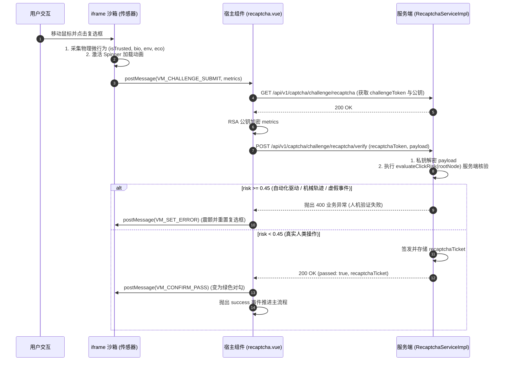

# reCAPTCHA 人机验证架构回滚与纯服务端风险核验迁移设计方案

## 1. 变更背景与需求说明

在经历针对 PoW 算力锚点与动态滑块拼图（PUZZLE）升阶方案的尝试后，为保持系统最初的轻量化设计哲学，并杜绝因物理网络延迟、本地测试环境时序差异或算力竞争引起的误判问题，根据最新指令：
1. **彻底回滚复杂化增量设计**：
   - 彻底移除客户端工作量证明（PoW `powSeed` / `powDifficulty` / `powNonce` 计算逻辑）；
   - 彻底移除 CLICK 模式下的动态升阶滑块拼图（PUZZLE）逻辑与服务端 150ms 因果律拦截；
   - 维持 `CloudTurnstileCaptchaProvider.java` 的移除状态（不引入第三方 Turnstile 驱动）；
2. **纯粹解决核心安全漏洞（将判定主体完整迁移至服务端）**：
   - **原高危漏洞根因**：原版本中，人机风险决策完全在前端 iframe 沙箱内部执行（`if (risk < 0.45) emit('VM_CHALLENGE_SUCCESS')`），服务端仅对提交的 RSA 密文进行解密，对微行为数据零校验即无条件签发 `recaptchaTicket`，造成客户端越权与人机绕过；
   - **本次改造目标**：前端 iframe 彻底剥离任何 `risk < 0.45` 判定与自颁发 Token 逻辑，仅作为原始物理事件与环境指纹采集器，将采集到的全量传感器数据打包加密提交至服务端；由服务端 `RecaptchaServiceImpl` 100% 全权执行原前端定义的完整风控数学模型，真正实现“前端只负责采集，后端统一做决策”。

---

## 2. 核心架构与职责划分

---

## 3. 详细改动点与全链路实现

### 3.1 前端重构 (`volur-lite-view-NEXT`)
1. **`recaptcha.vue` 脚本层精简**：
   - 彻底移除 `solvePoW` Web Crypto 计算函数；
   - 彻底移除组件挂载预拉取（Prefetching）与监听器复杂的暂存逻辑，恢复为原版简洁流线；
   - `handleBackendChallengeFlow` 直接使用 `getRecaptchaChallengeApi` 获取公钥，加密 `metrics` 并提交 `verifyRecaptchaChallengeApi`；
   - 验证成功后通过 `VM_CONFIRM_PASS` 驱动 iframe 转绿；失败或异常则触发 `VM_SET_ERROR` 震颤重置。
2. **`sandboxHtml` 沙箱层（移除非法客户端决策）**：
   - 彻底剔除 `var risk = 0.0; ... if (risk < 0.45)` 的自判与自签发 Token 逻辑；
   - 收集真实点击信任标志 `isTrusted = Boolean(downIsTrusted && upIsTrusted && clickIsTrusted)`；
   - 结构化打包 `bio`、`env`、`eco` 全量原始信号至 `payload`，单向投递 `VM_CHALLENGE_SUBMIT`。
3. **`api/captcha.ts` 类型定义归一**：
   - 回滚 `RecaptchaChallengeVO` 与 `RecaptchaVerifyVO`，清除 PoW 与动态升阶冗余字段，保持简洁强类型映射。

### 3.2 服务端风控模型落地 (`volur-security`)
1. **`RecaptchaChallengeVO.java` & `RecaptchaVerifyResponseVO.java`**：
   - 清除 `powSeed`、`powDifficulty` 等实验性字段，恢复至标准基线；
   - `RecaptchaVerifyResponseVO` 仅保留 `passed` 与 `recaptchaTicket`。
2. **`RecaptchaServiceImpl.java` 核心风控迁移**：
   - **解密与凭据校验**：RSA 私钥解密后校验时间戳有效性（120s 内防重放）；
   - **`evaluateClickRisk` 服务端闭环评估**：
     - **真实事件判定**：`!isTrusted` 一票累加 `1.0` 风险（直接超标拒绝）；
     - **自动化与伪造环境**：`wd`、`cdp`、`protoTampered` 累加 `0.85`；`headless`、`zeroOuter` 累加 `0.70`；`webglSoftware` 累加 `0.45`；`coreHook` / `extHookCount` 累加 `0.35`；`screenInconsistent` / `hardwareSpoofed` 累加 `0.45`；
     - **生物动力学特征**：总耗时 `dur < 20ms` 或 `> 3000ms` 加权 `0.45`，`45ms ~ 350ms` 扣减 `-0.10`；靶心定点 `isCenterTarget` 累加 `0.65`，正常落靶 `inActionBounds` 扣减 `-0.08`；静止/机械直线/瞬移特征加权 `0.65 ~ 0.80`，自然微抖动 `accVar > 0.000005 && pts >= 4` 扣减 `-0.25`；
     - **生态上下文**：无历史且无存储特征加权 `0.15`，时序零特征加权 `0.15`；
     - 归一化计算 `risk = Math.max(0.0, Math.min(1.0, risk))`；
   - **决策分流**：
     - 若 `risk >= 0.45`：记录风控失败日志并调用 `riskEvaluationEngine.recordFailure`，抛出 `BusinessException` 快速失败；
     - 若 `risk < 0.45`：正常签发 `recaptchaTicket` 写入 Redis 并返回。

---

## 4. 测试与构建验证

1. **后端单元测试**：
   - `RecaptchaServiceImplTest.java` 覆盖正常人类点击放行、非信任事件拦截、自动化驱动拦截、空载荷拦截、拼图模式与票据单次销毁等 10 个测试用例，`mvn test -pl volur-security` 全部通过；
   - 全平台全模块测试（`volur-framework`、`volur-logging`、`volur-system`、`volur-user`、`volur-verification`、`volur-security`、`volur-notification`、`volur-auth`）共计 58 + 96 个测试用例全部 **100% SUCCESS**。
2. **前端类型与编译检查**：
   - 执行 `npm run build`（`vue-tsc --noEmit && vite build`），全端 **0 语法与类型错误通过**。

---

## 5. 文件变更清单

| 文件路径 | 变更类型 | 说明 |
| :--- | :--- | :--- |
| `src/volur-lite-view-NEXT/src/components/security/recaptcha.vue` | 修改 | 回滚 PoW 与预加载，移除前端 risk 计算，纯委托后端核验 |
| `src/volur-lite-view-NEXT/src/api/captcha.ts` | 修改 | 回滚接口定义至简洁基线 |
| `src/volur-lite-platform/volur-security/.../RecaptchaChallengeVO.java` | 修改 | 移除 PoW 字段 |
| `src/volur-lite-platform/volur-security/.../RecaptchaVerifyResponseVO.java` | 修改 | 移除升阶字段，仅保留 passed 与 ticket |
| `src/volur-lite-platform/volur-security/.../ReCAPTCHAChallengeController.java` | 修改 | 简化验证成功提示信息 |
| `src/volur-lite-platform/volur-security/.../RecaptchaServiceImpl.java` | 修改 | 核心风控模型迁移至服务端 evaluateClickRisk |
| `src/volur-lite-platform/volur-security/.../RecaptchaServiceImplTest.java` | 修改 | 适配纯服务端风险计算用例集 |
| `agent/volur-design-md/2026-10-08-rollback-recaptcha-and-migrate-verification-to-backend.md` | 新增 | 本次架构回滚与服务端迁移审计文档 |
