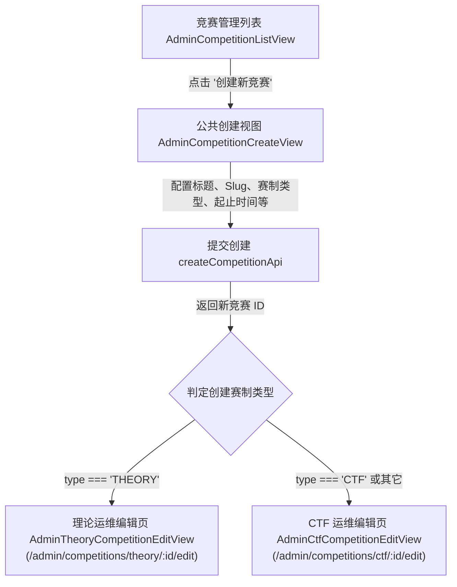

# 竞赛创建流程与赛制模式选择解耦重构方案说明

## 1. 变更背景与问题分析

在 Volur 平台管理后台中，原有的竞赛创建与编辑体系通过 `AdminCompetitionEditView.vue` 统一承载。然而存在以下交互与架构设计断层：
1. **赛制模式被置灰且仅有单一选项**：
   在底层具体的 CTF 编辑视图 `AdminCtfCompetitionEditView.vue` 和理论编辑视图 `AdminTheoryCompetitionDetailView.vue` 中，赛制模式下拉框 `<VSelection>` 均硬编码了 `:disabled="true"`，且可选项 `typeOptions` 仅包含当前单一赛制，导致管理员无法自由选择。
2. **包装容器默认回退缺陷**：
   原 `AdminCompetitionEditView.vue` 扮演了 Wrapper 分发器角色。但当管理员在竞赛列表点击“创建新竞赛”访问 `/admin/competitions/create` 时，未携带 `?type=` 查询参数，容器静默回退并渲染了 `AdminCtfCompetitionEditView.vue`，使创建者误以为只能创建 CTF 竞赛且无法切换赛制。
3. **职责耦合**：
   创建态（无 `id`）与编辑运维态（已有 `id` 挂载赛题、公告、战队、日志）杂糅在同一组件中，导致赛制类型的选择阶段与后续不同赛制的复杂运维面板耦合。

---

## 2. 核心架构重构设计

针对上述问题，确立了“**创建公共视图独立化 + 创建完成按赛制分流运维**”的架构解耦方案：

---

## 3. 具体改动清单

### 3.1 新增公共创建视图 `AdminCompetitionCreateView.vue`
- **文件路径**：`src/views/admin/competition/AdminCompetitionCreateView.vue`
- **核心功能**：
  - 提供竞赛基础配置表单：竞赛名称、Slug、赛制模式、竞赛状态、Banner 封面图、简介与规则 Markdown、竞赛起止时间、报名起止时间、战队审核开关；
  - **自由可选赛制模式**：`<VSelection>` 开放编辑能力，提供 `CTF`（解题赛）、`THEORY`（理论答题赛）、`AWD`（攻防对抗）、`AWD_PLUS`（综合攻防）、`ISW`（靶场实战）全量可选项；
  - **创建态状态强约束为“草稿”**：新建阶段的“竞赛状态”固定置灰且仅有 `DRAFT` 单一选项，提交 Payload 强绑定 `status: 'DRAFT'`，禁止在创建阶段直接发布或切换状态；所有状态流转（发布、报名、开始、封榜、归档）必须在创建完成后的 Edit 运维视图中进行，与后端业务模型严格保持单一真实源；
  - **前置与兼容参数识别**：在 `onMounted` 阶段自适应解析路由路径（如 `/theory/create`）及 `route.query.type` 参数，提供默认选中值；
  - **强类型与时间校验**：校验标题、Slug、起止时间非空，严格限制竞赛开始时间早于结束时间、报名开始早于报名结束且不晚于比赛结束时间；
  - **精准分流路由导航**：调用 `createCompetitionApi` 成功后，根据用户所选的 `formData.type`，理论赛跳转至 `/admin/competitions/theory/${id}/edit`，CTF 或其它赛制跳转至 `/admin/competitions/ctf/${id}/edit`。

### 3.2 路由分发重构 `src/router/routes/admin.ts`
- 将 `/admin/competitions/create`、`/admin/competitions/ctf/create` 与 `/admin/competitions/theory/create` 的加载组件统一对齐至 `AdminCompetitionCreateView.vue`；
- 保持各赛制已有详情运维路由（`/admin/competitions/ctf/:id/edit`、`/admin/competitions/theory/:id/edit` 及通用 `/admin/competitions/:id/edit`）职责单一。

### 3.3 路由守护与异常回退 `AdminCompetitionEditView.vue`
- 当管理员意外在没有 `id` 参数的情况下访问 `AdminCompetitionEditView.vue` 时，自动通过 `router.replace('/admin/competitions/create')` 引导回流到统一创建视图，消除悬挂空表单可能。

### 3.4 动态运行态与人工控制态解耦（消除伪造/手动指定进行中与报名中）
- **问题与业务逻辑**：在竞赛全生命周期中，“报名中 (`REGISTRATION`)”、“进行中 (`RUNNING`)”、“已结束 (`ENDED`)”是严格基于系统时间与赛程设置（`startTime`、`endTime`、`regStartTime`、`regEndTime`）由后端 `resolveStatusByTime()` 动态计算得出的运行时态，不应由管理员在表单中手动设置或伪造；
- **人工干预收敛为【草稿 / 已发布】**：
  - 在 [AdminCtfCompetitionEditView.vue](file:///H:/HuMoLix/github/Volur-Lite/src/volur-lite-view-NEXT/src/views/admin/competition/AdminCtfCompetitionEditView.vue) 和 [AdminTheoryCompetitionDetailView.vue](file:///H:/HuMoLix/github/Volur-Lite/src/volur-lite-view-NEXT/src/views/admin/competition/AdminTheoryCompetitionDetailView.vue) 中，移除了手动选择 `REGISTRATION`、`RUNNING`、`ENDED` 及 `ARCHIVED` 的选项；
  - 表单中的“竞赛状态”仅提供 `DRAFT`（草稿/下架）与 `PUBLISHED`（已发布/按时间自动运行）供管理员手动切换；
  - 若竞赛处于已归档（`ARCHIVED`），状态选项显示为 `已归档 (只读)` 并锁定置灰，严格遵从专用归档接口规则；
- **实时运行状态彩色 Badge 呈现**：在表单状态标签旁新增彩色 Badge，实时展示后端根据时间动态计算出的实际状态（如：“实时状态: 进行中”、“实时状态: 报名中”、“实时状态: 已结束”），提供高度清晰的自解释视觉反馈。

---

## 4. 规范遵守与代码质量审计

1. **纯粹代码与零注释铁律**：所有新增及调整的代码文件保持极致纯粹，杜绝行内解释性注释与冗余备注，设计意图由本文档外置维护；
2. **Google 主题色彩与设计对齐**：使用 Google Gray 文本阶梯色（`text-google-text-primary`、`text-google-text-secondary`）、Google 浅灰与深黑卡片表面、Google Blue 主要操作按钮；
3. **Fail-Fast 原则**：未配置或格式非法的数据直接阻断并弹出强类型提示，创建成功返回 `id` 缺失时回退至列表页，不进行隐式假数据伪造；
4. **编译与打包验证**：执行 `npm run build` 成功构建，产物包含 `AdminCompetitionCreateView` 独立 Chunk，无 TypeScript 校验与打包报错。
