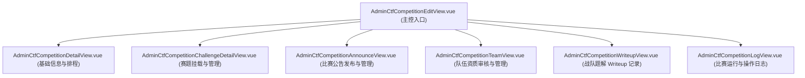

# CTF 竞赛管理页面 Tabs 组件化拆分与队伍资质审核重构说明

## 1. 变更背景与动因

在重构前，新一代前端工程管理端中的 CTF 竞赛编辑视图 [`AdminCtfCompetitionEditView.vue`](file:///H:/HuMoLix/github/Volur-Lite/src/volur-lite-view-NEXT/src/views/admin/competition/AdminCtfCompetitionEditView.vue) 为单文件大单体结构（超过 1000 行），将基本信息与排程设置、赛题挂载、比赛专属公告、战队审核、题解 Writeup 提交记录以及运行日志等全部集中于单一组件内。这导致了状态耦合严重、视图职责臃肿、单文件维护成本高以及代码复用困难等问题。

为保持系统架构一致性，对齐此前对理论竞赛编辑视图 [`AdminTheoryCompetitionEditView.vue`](file:///H:/HuMoLix/github/Volur-Lite/src/volur-lite-view-NEXT/src/views/admin/competition/AdminTheoryCompetitionEditView.vue) 的组件化重构标准，本次重构对 `AdminCtfCompetitionEditView.vue` 中的各个 Tab 进行深度物理拆分与解耦：
1. 以 `AdminTheoryCompetitionEditView.vue` 为标准架构范例，将所有选项卡拆分为独立的子业务组件；
2. 全面采用平台通用表格组件 [`VTable.vue`](file:///H:/HuMoLix/github/Volur-Lite/src/volur-lite-view-NEXT/src/components/common/VTable.vue) 统一各个选项卡内的数据列表与交互呈现；
3. 将基础信息表单中的“开启参赛战队资质审核 (队长报名后需管理员通过)”迁移至战队管理选项卡中统一维护。

---

## 2. 架构设计与拆分方案

将原单体视图拆分为 1 个轻量主控入口视图与 6 个高内聚独立业务视图：

### 2.1 组件职责与分工

1. **主控入口 [`AdminCtfCompetitionEditView.vue`](file:///H:/HuMoLix/github/Volur-Lite/src/volur-lite-view-NEXT/src/views/admin/competition/AdminCtfCompetitionEditView.vue)**
   - 负责解析路由参数 `id` 并判定编辑态与新建态；
   - 维护顶部竞赛动态标题与选项卡导航组 [`VFilterBtnGroup`](file:///H:/HuMoLix/github/Volur-Lite/src/volur-lite-view-NEXT/src/components/common/VFilterBtnGroup.vue)；
   - 条件渲染对应的拆分子视图，主入口精简至约 70 行。

2. **基础信息与排程 [`AdminCtfCompetitionDetailView.vue`](file:///H:/HuMoLix/github/Volur-Lite/src/volur-lite-view-NEXT/src/views/admin/competition/AdminCtfCompetitionDetailView.vue)**
   - 负责 CTF 竞赛标题、Slug、赛制类型、当前状态、封面 Banner 上传以及 Markdown 规则简介的维护；
   - 负责比赛起止时间与报名起止时间的校验、ISO 8601 时间戳转换与更新操作；
   - 移除原先混杂在基础信息中的“开启参赛战队资质审核”勾选框；
   - 向上通知标题变更与保存成功事件。

3. **赛题挂载与管理 [`AdminCtfCompetitionChallengeDetailView.vue`](file:///H:/HuMoLix/github/Volur-Lite/src/volur-lite-view-NEXT/src/views/admin/competition/AdminCtfCompetitionChallengeDetailView.vue)**
   - 负责已挂载题目列表的展示与卸载操作；
   - 采用 `VTable`（无外边框 `:bordered="false"`，紧凑尺寸 `size="small"`，小型操作按钮 `size: 'small'`）；
   - 模态框挂载题库赛题并配置初始分值与衰减底分。

4. **比赛专属公告 [`AdminCtfCompetitionAnnounceView.vue`](file:///H:/HuMoLix/github/Volur-Lite/src/volur-lite-view-NEXT/src/views/admin/competition/AdminCtfCompetitionAnnounceView.vue)**
   - 采用标准 `VTable` 展示专属公告，空数据采用标准占位；
   - 模态框支持发布公告与确认删除拦截。

5. **队伍管理与战队审核 [`AdminCtfCompetitionTeamView.vue`](file:///H:/HuMoLix/github/Volur-Lite/src/volur-lite-view-NEXT/src/views/admin/competition/AdminCtfCompetitionTeamView.vue)**
   - **承载资质审核总开关**：在顶部显式提供“开启参赛报名战队资质审核”开关卡片，支持实时切换并同步持久化至后端配置；
   - 展现全部战队、待审核、已通过、已驳回四项核心指标概览卡片；
   - 检索与筛选工具栏取消多余外层内边距，右侧对齐查询按钮；
   - 多选行批量操作栏（批量通过、批量驳回原因录入、批量删除）；
   - 采用标准 `VTable`（无外边框、紧凑尺寸、小型操作按钮），外置挂载小型分页组件 `VPagination`。

6. **题解 Writeup 管理 [`AdminCtfCompetitionWriteupView.vue`](file:///H:/HuMoLix/github/Volur-Lite/src/volur-lite-view-NEXT/src/views/admin/competition/AdminCtfCompetitionWriteupView.vue)**
   - 采用标准 `VTable` 展示战队名称、提交人、文件链接与评阅得分，对齐全局列表视觉规范。

7. **比赛日志与审计 [`AdminCtfCompetitionLogView.vue`](file:///H:/HuMoLix/github/Volur-Lite/src/volur-lite-view-NEXT/src/views/admin/competition/AdminCtfCompetitionLogView.vue)**
   - 采用标准 `VTable` 展示操作人、所属战队、行为事件动作、状态与记录时间，外置挂载小型分页组件 `VPagination`。

---

## 3. 规范遵守与验证

1. **纯粹代码与零注释铁律**：全部新增及重构的 `.vue` 文件严格剔除任何行内解释性注释，代码实现自解释；
2. **Google 风格色彩规范**：严格使用 Google Blue (`#1a73e8`)、Google Green (`#34a853`)、Google Yellow (`#fbbc04`) 与 Google Red (`#ea4335`) 的层级色彩体系；
3. **工程构建验证**：执行 `vue-tsc --noEmit && vite build`，编译打包无任何错误，产物校验通过。
