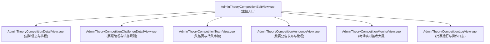

# 理论竞赛管理页面 Tabs 组件化拆分与队伍页 VTable 重构说明

## 1. 变更背景与动因

在重构前，新一代前端工程管理端中的理论竞赛编辑视图 [`AdminTheoryCompetitionEditView.vue`](file:///H:/HuMoLix/github/Volur-Lite/src/volur-lite-view-NEXT/src/views/admin/competition/AdminTheoryCompetitionEditView.vue) 为单文件大单体结构（超过 1000 行），将基础信息与排程、理论试卷抽题规则、比赛专属公告、战队审核、监考大屏调度以及运行日志等全部集中于单一组件内。这导致了状态耦合严重、渲染职责混乱、单文件维护成本高以及代码复用困难等问题。

为提升组件高内聚与低耦合度，遵循统一的 Google Material Design 3 设计规范及现代化前端架构标准，本次重构对 `AdminTheoryCompetitionEditView.vue` 中的各个 Tab 进行深度解耦与物理拆分，同时在队伍页中全面采用平台通用表格组件 [`VTable.vue`](file:///H:/HuMoLix/github/Volur-Lite/src/volur-lite-view-NEXT/src/components/common/VTable.vue) 重构原有数据列表与交互体系。

---

## 2. 架构设计与拆分方案

将原单体视图拆分为 1 个轻量主控入口视图与 6 个高内聚独立业务视图：

### 2.1 组件职责与分工

1. **主控入口 [`AdminTheoryCompetitionEditView.vue`](file:///H:/HuMoLix/github/Volur-Lite/src/volur-lite-view-NEXT/src/views/admin/competition/AdminTheoryCompetitionEditView.vue)**
   - 负责解析路由参数 `id` 并判定编辑态与新建态；
   - 维护顶部竞赛动态标题与选项卡导航组 [`VFilterBtnGroup`](file:///H:/HuMoLix/github/Volur-Lite/src/volur-lite-view-NEXT/src/components/common/VFilterBtnGroup.vue)；
   - 按需条件渲染对应的拆分子视图，代码行数精简至数十行。

2. **基础信息与排程 [`AdminTheoryCompetitionDetailView.vue`](file:///H:/HuMoLix/github/Volur-Lite/src/volur-lite-view-NEXT/src/views/admin/competition/AdminTheoryCompetitionDetailView.vue)**
   - 负责理论竞赛标题、Slug、赛制类型、当前状态、封面 Banner 上传以及 Markdown 规则简介的维护；
   - 负责比赛起止时间与报名起止时间的校验、ISO 8601 时间戳转换与更新操作；
   - 向上通知标题变更与保存成功事件。

3. **赛题管理与试卷规则 [`AdminTheoryCompetitionChallengeDetailView.vue`](file:///H:/HuMoLix/github/Volur-Lite/src/volur-lite-view-NEXT/src/views/admin/competition/AdminTheoryCompetitionChallengeDetailView.vue)**
   - 负责关联多个理论题库 (`bankIds`) 的选择与检索；
   - 独立配置单选题、多选题、判断题与主观问答题的题目抽取数量与每题分值；
   - 控制随机抽取题序与打乱选项的作弊防御开关。

4. **队伍页与战队审核 [`AdminTheoryCompetitionTeamView.vue`](file:///H:/HuMoLix/github/Volur-Lite/src/volur-lite-view-NEXT/src/views/admin/competition/AdminTheoryCompetitionTeamView.vue)**
   - 负责战队报名人工资质审核机制开关的实时切换与持久化；
   - 展现全部战队、待审核、已通过、已驳回四项核心指标概览卡片；
   - **全面采用 [`VTable.vue`](file:///H:/HuMoLix/github/Volur-Lite/src/volur-lite-view-NEXT/src/components/common/VTable.vue) 承载核心数据表格**，提供队伍名称、队长用户名、成员人数、审核状态标签、报名时间与操作栏；
   - 支持多选勾选行与批量通过、批量驳回、批量删除快捷操作栏；
   - 集成队伍报名驳回原因弹窗与战队完整资料/成员清单明细弹窗。

5. **比赛专属公告 [`AdminTheoryCompetitionAnnounceView.vue`](file:///H:/HuMoLix/github/Volur-Lite/src/volur-lite-view-NEXT/src/views/admin/competition/AdminTheoryCompetitionAnnounceView.vue)**
   - 负责比赛内部公告的列表呈现与实时拉取；
   - 提供基于模态框的公告编写发布流程与删除防护。

6. **考场实时监考大屏 [`AdminTheoryCompetitionMonitorView.vue`](file:///H:/HuMoLix/github/Volur-Lite/src/volur-lite-view-NEXT/src/views/admin/competition/AdminTheoryCompetitionMonitorView.vue)**
   - 调度现有考场大屏监考组件 [`AdminTheoryCompetitionTeamMonitor.vue`](file:///H:/HuMoLix/github/Volur-Lite/src/volur-lite-view-NEXT/src/views/admin/competition/components/AdminTheoryCompetitionTeamMonitor.vue)，监控在线状态、全屏防切屏与实时屏幕帧画面。

7. **比赛日志与审计 [`AdminTheoryCompetitionLogView.vue`](file:///H:/HuMoLix/github/Volur-Lite/src/volur-lite-view-NEXT/src/views/admin/competition/AdminTheoryCompetitionLogView.vue)**
   - 通过 `VTable` 清晰展示操作人、所属战队、行为事件动作、成功/失败状态与发生时间，并支持分页与快速刷新。

---

## 3. 队伍页 VTable 重构落地细节

在 [`AdminTheoryCompetitionTeamView.vue`](file:///H:/HuMoLix/github/Volur-Lite/src/volur-lite-view-NEXT/src/views/admin/competition/AdminTheoryCompetitionTeamView.vue) 中，彻底消除了原有的松散列表实现，完全对齐平台统一的表格组件体系：

1. **类型安全与列配置**：使用 `DataTableColumns<AdminTeamListVO>` 严格定义各列，支持多选列 (`type: 'selection'`)、Google 风格状态色彩徽章渲染以及动作触发器；
2. **检索与筛选联动**：通过搜索输入框与状态下拉选择器联动后端分页接口 `listAdminTeamsApi`，支持关键词过滤与状态隔离；
3. **批量操作体验**：勾选表格行后，动态渲染批量操作操作条，提供批量审核通过 (`batchAuditAdminTeamsApi`)、批量填写驳回理由 (`showBatchRejectModal`) 与批量删除安全拦截；
4. **分页控制**：无缝接收 `VTable` 的 `@update:page` 与 `@update:page-size`，具备服务端受控分页联动。

---

## 4. 规范遵守与验证

1. **零注释铁律**：重构涉及的全部 `.vue` 代码文件严格杜绝了解释性注释与冗余说明，代码保持高度纯净与自解释性；
2. **Google 风格色彩规范**：严格使用 Google Blue (`#1a73e8`)、Google Green (`#34a853`)、Google Yellow (`#fbbc04`) 与 Google Red (`#ea4335`) 的层级色彩体系；
3. **工程构建验证**：执行 `vue-tsc --noEmit && vite build`，编译打包无任何错误，产物校验通过。

---

## 5. 队伍页交互与排版精细化调优 (Refinements)

根据二次评审反馈，对 [`AdminTheoryCompetitionTeamView.vue`](file:///H:/HuMoLix/github/Volur-Lite/src/volur-lite-view-NEXT/src/views/admin/competition/AdminTheoryCompetitionTeamView.vue) 进行了如下精准改进：

1. **去除工具栏外层冗余内边距**：移除筛选工具栏容器原有的 `p-4`，保证与全局网格及表格两端严格齐平；
2. **修复审核状态参数类型不匹配缺陷**：后端 `TeamStatus` 枚举对应待审核状态值为 `AUDIT_DRAFT`，将筛选选项由历史别名 `PENDING_AUDIT` 纠正为 `AUDIT_DRAFT`，彻底杜绝接口 400 “请求参数类型不匹配: status” 异常；
3. **工具栏按钮布局与层级调整**：
   - 将“刷新列表”按钮调整至“重置”按钮左侧，保持左侧为统一检索过滤控制区；
   - 将“查询”按钮移至工具栏最右侧，并调整其样式属性 `clz="normal"`，实现主次清晰、视觉平衡；
4. **表格分页外置解耦与尺寸微调**：将 `VTable` 内部的 `pagination` 属性显式设置为 `false`，并在表格正下方挂载全局标准的分页组件 [`VPagination.vue`](file:///H:/HuMoLix/github/Volur-Lite/src/volur-lite-view-NEXT/src/components/common/VPagination.vue)，尺寸设置为 `size="small"`，同时将 `VTable` 调整为 `:bordered="false"` 无外边框模式，保持与页面整体背景及间距的极简融合；
5. **精简表格字体与文字排版样式**：彻底剥离列渲染函数中多余的 `font-mono` (Fira Code) 及药丸胶囊背景边框样式，原生继承 `VTable.vue` 自带的 Inter 字体与主题文本色，审核状态改用轻量语义彩色文本呈现；
6. **操作按钮尺寸统一微型化**：将操作列中的全部 `VBtn` 组件尺寸统一由 `medium` 缩减为 `small`，提升数据表格的操作紧凑度与视界整洁度；
7. **公告页与日志页表格同步对齐规范**：
   - 在 [`AdminTheoryCompetitionAnnounceView.vue`](file:///H:/HuMoLix/github/Volur-Lite/src/volur-lite-view-NEXT/src/views/admin/competition/AdminTheoryCompetitionAnnounceView.vue) 中，设置 `:bordered="false"`，将表格列标题、正文及操作按钮完全继承 `VTable` 默认字体排版，删除操作按钮尺寸调整为 `size="small"`；
   - 在 [`AdminTheoryCompetitionLogView.vue`](file:///H:/HuMoLix/github/Volur-Lite/src/volur-lite-view-NEXT/src/views/admin/competition/AdminTheoryCompetitionLogView.vue) 中，设置 `:bordered="false"`，移除所有 `font-mono`，直接返回字段文本以继承 `VTable` 样式，状态列采用轻量语义彩色文字，并将分页外置挂载为 `VPagination` (`size="small"`)；
8. **移除基础信息排程中的“实时状态”指示徽章**：
   - 在 [`AdminTheoryCompetitionDetailView.vue`](file:///H:/HuMoLix/github/Volur-Lite/src/volur-lite-view-NEXT/src/views/admin/competition/AdminTheoryCompetitionDetailView.vue) 与 [`AdminCtfCompetitionEditView.vue`](file:///H:/HuMoLix/github/Volur-Lite/src/volur-lite-view-NEXT/src/views/admin/competition/AdminCtfCompetitionEditView.vue) 中，同步移除“竞赛状态”标签右侧的 `实时状态: {{ runtimeStatusLabel }}` 徽章及相关计算属性，保持平台管理端表单视觉统一，彻底消除冗余状态提示。

