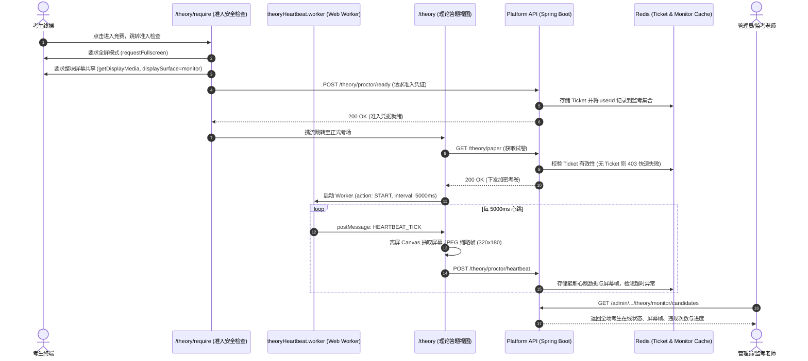

# 理论竞赛强反作弊准入检测、Web Worker 时序心跳与管理端监考大屏设计方案

## 1. 变更背景与需求概述

针对线上理论知识考核（THEORY）的严肃性与防舞弊需求，此前已完成第一阶段反作弊事件上报（切屏、失焦、开发者工具、受限快捷键及多重封禁）与真实试卷 API 接入。本次升级进一步深化强反作弊闭环体系，针对绕过作弊、刷新阻断、屏幕假共享等典型作弊风险进行全链路防御架构升级：

1. **考场准入前置安全检查（/require）**：考生进入理论竞赛后，强制前置路由至 `/competitions/:id/theory/require`。在准入页严格核验终端全屏模式及整块屏幕共享授权（`displaySurface === 'monitor'`，禁止窗口或单标签页），点击核验通过并向服务端申请监考准入凭证后，方可进入试卷答题页；
2. **防绕过全链路双重校验**：
   - **后端凭证拦截**：考生在准入页完成校验时，服务端生成基于 Redis 的临时监考准入 Ticket（`vredis:competition:theory:ticket:<compId>:<userId>`）。考生调用试题拉取接口 `GET /paper` 时，后端强校验该 Ticket，未通过准入页的非法或绕过请求直接拦截并返回 `403 FORBIDDEN`；
   - **前端状态与流存活检测**：在 `/theory` 视图中挂载检验，若检测到内存中共享流失效或未通过准入状态，立即强制退回 `/require` 引导页；
3. **Web Worker 独立时序心跳上报**：在试卷拉取成功后，前端启动独立线程 Web Worker（`src/workers/theoryHeartbeat.worker.ts`），以 5000ms 周期向主线程触发 Tick，上报全屏状态、监控流活跃度、离屏 Canvas 抽取的 Base64 JPEG 缩略帧及答题进度。后端实时更新状态并检验两次心跳时间差（若大于 25s 则记录异常中断日志至 `CompetitionOperationLog`）；
4. **管理端实时监考大屏（AdminTheoryCompetitionTeamMonitor.vue）**：在管理端理论竞赛编辑页中新增「监考大屏」Tab，支持 5s 自动轮询拉取所有在册考生的实时状态、在线标记、全屏状态、违规累计、答题进度及屏幕缩略图，并提供大图实时弹窗查验。

---

## 2. 系统核心架构与时序设计

---

## 3. 详细改动清单与实现说明

### 3.1 领域模型与 API 层
- **`src/types/competition/index.ts`**：
  - 新增 `TheoryProctorHeartbeatDTO`：心跳上报模型（`fullscreen`, `screenActive`, `screenFrame`, `timestamp`, `answeredCount`, `totalCount`）；
  - 新增 `TheoryProctorHeartbeatVO`：心跳响应模型（`acknowledged`, `isBanned`, `violationCount`, `maxAllowedViolations`, `serverTime`）；
  - 新增 `AdminTheoryCandidateMonitorVO`：管理员监考大屏数据视图（`userId`, `username`, `realName`, `teamName`, `isOnline`, `fullscreen`, `screenActive`, `screenFrame`, `violationCount`, `isBanned`, `answeredCount`, `totalCount`, `lastHeartbeatTime`）。
- **`src/api/competition.ts`**：
  - 新增 `registerProctorReadyApi(competitionId)`：调用 `POST /api/v1/competitions/{competitionId}/theory/proctor/ready`；
  - 新增 `sendProctorHeartbeatApi(competitionId, data)`：调用 `POST /api/v1/competitions/{competitionId}/theory/proctor/heartbeat`；
  - 新增 `getAdminTheoryCandidateMonitorsApi(competitionId)`：调用 `GET /api/v1/admin/competitions/{competitionId}/theory/monitor/candidates`。

### 3.2 监考状态存储与 Web Worker
- **`src/store/modules/proctor.ts`**：
  - 采用 Pinia Setup Store 管理考场媒体流 `screenStream`、准入标记 `isPrecheckPassed` 及竞赛 ID；
  - 提供 `setProctorReady(id, stream)` 与 `clearProctorState()` 生命周期清理函数，防止流残留或内存泄漏。
- **`src/workers/theoryHeartbeat.worker.ts`**：
  - 独立线程高精度定时器（不受标签页切出降频影响），接收 `START` 与 `STOP` 指令，定时派发 `HEARTBEAT_TICK` 事件至主线程。

### 3.3 准入检测视图与考场改造
- **`src/views/competition/TheoryCompetitionRequireView.vue`**：
  - 实现全屏模式检测与切换控制；
  - 调用 `navigator.mediaDevices.getDisplayMedia` 校验 `stream.getVideoTracks()[0].getSettings().displaySurface === 'monitor'`，若用户选择窗口或标签页则立即切断并报错拦截；
  - 实时视频画面微缩预览（`<video>`）与考生诚信承诺勾选；
  - 校验通过后调用 `registerProctorReadyApi`，更新 `proctorStore` 并平滑跳转至正式考场。
- **`src/views/competition/TheoryCompetitionView.vue`**：
  - `onMounted` 及 `fetchCompetitionAndPaper` 中核验 `proctorStore` 凭据；若检测到无流或直接 URL 访问，自动重定向至 `/require`；若已被封禁或已交卷，展示对应视图；
  - 试卷拉取成功后挂载离屏 Canvas（320x180 质量 0.5 JPEG）抽取视频帧，与 Worker 配合持续发送心跳；
  - 交卷成功、考场封禁或组件卸载时调用 `stopProctoring()` 销毁 Worker、终止媒体流并退出全屏。

### 3.4 管理端监考大屏与编辑页集成
- **`src/views/admin/competition/components/AdminTheoryCompetitionTeamMonitor.vue`**：
  - 顶部指标卡片展示考生总数、在线答题中、违规告警中及封禁考生数；
  - 支持多状态快速过滤（全部、仅在线、有违规、已封禁）与关键词搜索；
  - 考场网格卡片实时展示各考生姓名、战队、全屏监控状态、屏幕共享活跃度、答题进度条、屏幕帧微缩图及最后上报时序标签；
  - 集成 `VModal` 弹窗支持大图查验；
  - 支持 5 秒自动轮询开/关与手动刷新。
- **`src/views/admin/competition/AdminTheoryCompetitionEditView.vue`**：
  - 在选项卡配置中加入 `monitor` Tab（`DesktopOutline` 图标），挂载 `AdminTheoryCompetitionTeamMonitor`。

### 3.5 路由与入口配置
- **`src/router/routes/competition.ts`**：
  - 新增 `/competitions/:id/theory/require` 与短链 `/c/:id/theory/require` 路由；
- **`src/views/competition/CompetitionDetailView.vue`**：
  - 将理论竞赛的 `enterArena` 入口重定向至 `/theory/require` 检查页。

---

## 4. 规范与纯粹性审计

1. **零行内注释与文档外置铁律**：所有修改及新增的 TypeScript、Vue 代码文件均彻底移除行内解释性注释与冗余备注，所有设计推导收敛在本文档中；
2. **色彩规范对齐**：全面采用 Google Material Design 体系（Google Blue `#1a73e8`、Google Green `#34a853`、Google Red `#ea4335`、Google Yellow `#fbbc04`，暗色基底 `#202124` / `#292a2d`，文本杜绝刺眼纯黑）；
3. **类型安全与零 Mock**：`vue-tsc --noEmit` 静态类型检查 100% 通过，杜绝隐式 Mock 与假数据兜底，未配置或未授权一律快速失败（Fail-Fast）。
