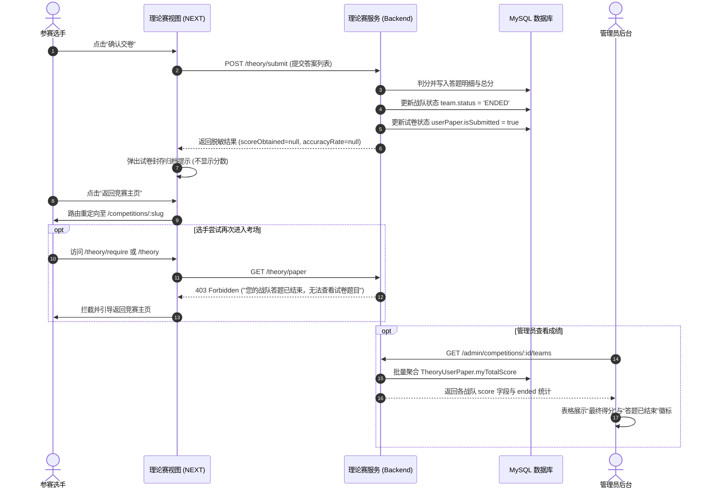

# 理论知识竞赛提交状态流转 (ENDED) 与分数防泄露改造设计方案

## 1. 变更背景与需求概述

在理论知识竞赛（Theory Competition）的线上考核场景中，为防止答题完成后答案泄露、题目截屏传播以及选手间交流试卷分数，提出了以下业务逻辑重构需求：
1. **答题状态设为 ENDED 并阻断查卷**：
   - 选手点击确认提交试卷后，将其参赛队伍的状态流转置为 `ENDED`（已结束）；
   - 当队伍状态为 `ENDED` 时，系统全链路阻断试卷题目获取与查卷接口，防止交卷后继续查看题目。
2. **提交后选手端隐藏成绩，仅管理员后台可见**：
   - 选手提交试卷后，服务端正常对所有题目进行判分并落库持久化（存入 `TheoryCompetitionAnswer` 与 `TheoryUserPaper.myTotalScore`）；
   - 服务端返回给非管理员选手的答题结果视图 `TheoryPaperResultVO` 中将得分、正确率与题数脱敏置空（`null`），杜绝接口响应抓包泄露成绩；
   - 选手端试卷页面及答题卡不再展示任何得分信息，提交成功后弹窗提示试卷已封存，并引导返回竞赛主页；
   - 管理员后台战队管理模块中展示各战队的最终考核成绩，并支持按照 `ENDED` 状态进行筛选与统计。

---

## 2. 核心架构与时序设计

---

## 3. 具体修改点

### 3.1 后端领域模型与服务 (Backend)

1. **`TeamStatus.java`**：
   - 增加枚举值 `ENDED(4, "ENDED")`，MySQL 持久化列 `competition_team.status` 为 `VARCHAR(32)`，无缝支持幂等字符串存储。
2. **`TheoryUserPaperRepository.java`**：
   - 增加 `findByCompetitionIdAndTeam_IdIn(Long competitionId, Collection<Long> teamIds)` 支持战队列表批量分数聚合；
   - 增加 `findFirstByTeam_Id(Long teamId)` 支持战队详情精准获取考核分数。
3. **`AdminTeamListVO.java` & `AdminTeamDetailVO.java` & `AdminTeamStatsVO.java`**：
   - `AdminTeamListVO` 新增 `private Integer score;`；
   - `AdminTeamDetailVO` 新增 `private Integer score;`；
   - `AdminTeamStatsVO` 新增 `private Long ended;`。
4. **`AdminTeamServiceImpl.java`**：
   - 注入 `TheoryUserPaperRepository`；
   - 在 `listTeams` 中批量查询并装配 `teamScoreMap`，赋入 `vo.setScore(...)`；
   - 在 `getTeamStats` 中统计 `countByCompetitionIdAndStatus(competitionId, TeamStatus.ENDED)`；
   - 在 `getTeam` 中通过 `findFirstByTeam_Id` 装配战队最终理论考核得分。
5. **`CompetitionScoreboardServiceImpl.java`**：
   - 综合计分榜参赛队伍过滤条件拓展为包含 `TeamStatus.AUDIT_PASSED` 与 `TeamStatus.ENDED`，确保答卷结束战队正常计入排行榜。
6. **`TheoryCompetitionServiceImpl.java`**：
   - 注入 `CompetitionTeamRepository teamRepository`；
   - `submitPaper`：
     - 若战队状态为 `ENDED` 或试卷已提交，直接抛出 `400 BAD_REQUEST` 阻断重复交卷；
     - 自动判卷落库后，将战队状态更新为 `team.setStatus(TeamStatus.ENDED)` 并保存；
     - 构建 `TheoryPaperResultVO`：普通选手角色下将 `correctCount`、`totalScore`、`scoreObtained`、`accuracyRate` 均脱敏置为 `null`；
   - `validateUserParticipationOrAdmin`：
     - 校验队伍状态，若 `team.getStatus() == TeamStatus.ENDED && !isAdmin`，立即抛出 `403 FORBIDDEN`（"您的战队答题已结束，无法查看试卷题目"）；
   - `getPaper`：
     - 判定若非管理员且 `userPaper.getIsSubmitted() == true`，直接抛出 `403 FORBIDDEN`；
   - `getMyApprovedTeam`：
     - 放行 `TeamStatus.AUDIT_PASSED` 与 `TeamStatus.ENDED`，保障交卷后监考心跳、日志记录与作答上报正常关联所属队伍；
   - `registerProctorReady`：
     - 调用 `validateUserParticipationOrAdmin`，已结束队伍无法再次激活全屏监考准入凭证。

---

### 3.2 前端工程与组件 (volur-lite-view-NEXT)

1. **类型契约 (`src/types/competition/index.ts`)**：
   - `TeamStatus` 联合类型追加 `'ENDED'`；
   - `TheoryPaperResultVO` 中的分数统计字段调整为可选/可空（`scoreObtained?: number | null` 等）；
   - `AdminTeamListVO` 与 `AdminTeamDetailVO` 增加 `score?: number | null`；
   - `AdminTeamStatsVO` 增加 `ended?: number`。
2. **多语言词条 (`src/locales/` `zh-CN`, `zh-TW`, `en-US`)**：
   - 追加 `theory_exam_ended_tip`（您的战队答题已结束，无法查看试卷题目）；
   - 追加 `theory_score_hidden_notice`（答卷已封存归档，最终成绩由管理员在后台统一核定）；
   - 追加 `theory_back_to_competition`（返回竞赛主页）；
   - 追加 `theory_exam_ended_badge`（答题已结束）。
3. **提交成功结果弹窗 (`TheoryResultModal.vue`)**：
   - 彻底移除得分卡片与正确率仪表盘，改为展示总答题数、试卷封存状态及成绩归档说明；
   - 确认按钮文本由“查看并复核答卷”调整为“返回竞赛主页”，触发后直接导航回竞赛主页。
4. **答题卡组件 (`TheoryPaperSheet.vue`)**：
   - 移除提交状态下底部 `myTotalScore` 分数展示，替换为试卷已封存归档说明。
5. **理论知识赛答题页 (`TheoryCompetitionView.vue`)**：
   - 顶部统计卡片移除“最终得分”展示；
   - 试卷提交完成弹窗确认或关闭时，强制重定向至 `/competitions/:slug`；
   - `fetchCompetitionAndPaper` 中增加防刷屏校验：若检测到战队状态为 `ENDED`（且非管理员）或试卷拉取返回 403 答题已结束时，提示并重定向至竞赛主页。
6. **准入检查页 (`TheoryCompetitionRequireView.vue`)**：
   - 检测到当前战队状态为 `ENDED` 时阻断进入监考检查，自动重定向至竞赛详情页。
7. **管理端战队管理页 (`AdminTheoryCompetitionTeamView.vue`)**：
   - 顶部统计卡片扩展为 5 列，增加“已结束”战队统计展示；
   - 状态筛选下拉框增加“已结束 (ENDED)”；
   - 表格新增“最终得分”列，渲染战队理论考核得分；
   - 状态列将 `ENDED` 显示为蓝色“答题已结束”高对比徽标；
   - 战队详情抽屉弹窗中增加“理论考核成绩”字段展示。

---

## 4. 安全防护与快速失败原则

1. **接口层 Fail-Fast**：接口直接在 Controller/Service 层进行队伍状态及准入校验，状态为 `ENDED` 且非管理员直接响应 `403 FORBIDDEN`，杜绝接口数据透传与抓包逆向；
2. **Zero-Mock & 数据单一真实源**：
   - 不在前端伪造任何占位成绩；
   - 真实得分严格由后端判题逻辑落库在 `TheoryUserPaper.myTotalScore` 与 `TheoryCompetitionAnswer.scoreObtained` 中，仅管理员端有权读取；
3. **零注释铁律**：所有修改的后端与前端源码均遵循纯净自解释规范，没有任何多余解释性行内注释。
